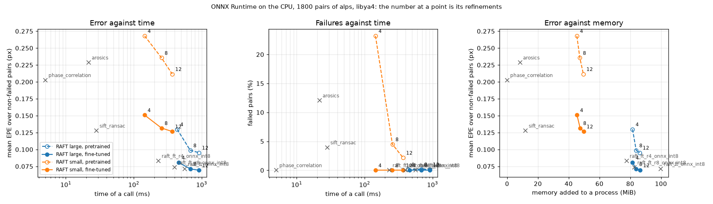

# ai-satellite-image-registration

**Aligning satellite images to a tenth of a pixel: classic methods vs AI.**

[](https://github.com/esamoun/ai-satellite-image-registration/actions/workflows/ci.yml)

Two images of the same place never line up exactly, and a change detector run
on them flags the misalignment as change. This project measures how well
classic and deep-learning methods recover the displacement between two
Sentinel-2 images, on accuracy and on compute cost. Displacements are simulated
on real imagery, so the ground truth is exact down to a fraction of a pixel.

[](https://esamoun.github.io/ai-satellite-image-registration/)

*The cost curve of the final evaluation, on the 1,800 pairs of the two
held-out sites: error and failed pairs against the time of a call on a laptop
CPU, and error against memory. Lower and further left is better.*

**[The demo page](https://esamoun.github.io/ai-satellite-image-registration/)**:
one pair per site, before and after each method's correction, and the cost
curve above, point by point. It computes nothing: it shows files `satreg demo`
wrote.

**Status: the four levels are done.** N1, the classic baseline; N2, classic
against pretrained deep-learning methods; N3, RAFT fine-tuned on this data and
evaluated once on two landscapes it never saw; N4, the command that registers
a pair of your own, the demo page and the container image.

## Run it

```bash
docker run --rm --network none ghcr.io/esamoun/ai-satellite-image-registration:1.0.0 register
```

With no method, `satreg register` lists the twelve methods the container image
runs, and stops. The container image holds `satreg`, ONNX Runtime, three classic
methods and the nine fine-tuned RAFT files, with the demo pairs, and runs with
no network. It does not hold PyTorch, the pretrained networks or AROSICS: the
full tables are reproduced outside it, with `make`.

From source, Python 3.11 or later:

```bash
python -m venv .venv && source .venv/bin/activate
make install
satreg register reference.tif moving.tif --method phase_correlation --out out/
satreg register reference.tif moving.tif --method raft_ft_onnx --out out/
```

Two examples, a classic method and the fine-tuned model, not a
recommendation: the method is always named, and there is no default. The
command writes the displacement, the corrected image and, for RAFT, the
displacement of every pixel. A pair is at most 512 px a side. The published
accuracy holds for 256 px windows of Sentinel-2 pairs: no figure of this
repository was measured on a pair you supply.

Everything else, from the container image and what it gave on a laptop to
each `make` target that reproduces a table, is in
[`docs/running.md`](docs/running.md).

## Results

**N3, the fine-tuned model:**
[the final evaluation](docs/evaluation.md#n3-fine-tuned-raft-the-final-evaluation).
The question and the criterion were written before any training, and the two
held-out sites, a mountain and a desert, were read once.

- **Fine-tuning pays on landscapes the training never saw.** On the 1,800
  held-out pairs, fine-tuned RAFT is at 0.069 px where the pretrained model is
  at 0.095 px, and it fails no pair. The gain is about 60 % of the one on the
  landscapes it was trained on.
- **It holds on real pairs.** The fine-tuned model fails none of the 384 real
  triplets where the pretrained one fails 89. Real pairs have no ground truth:
  closure says three estimates agree, not that they are right.
- **It does not take clean global motion from the classic methods.** Phase
  correlation with a Hann window stays at 0.005 px on clean translations,
  against 0.030 px. The fine-tuned model is the best of the twelve methods on
  the hardest pairs.
- **The cost curve.** The fine-tuned model with 4 refinements is more accurate
  than the pretrained one with 12, in half to two thirds of the time on a
  laptop CPU. A call of the large model takes 0.2 to 0.9 s on that CPU and
  under 50 ms on a T4, against 5 ms for phase correlation.

**N2, classic against pretrained:**
[the N2 tables](docs/evaluation.md#n2-classic-against-pretrained-methods).
AI wins where no global model describes the motion and where the two images do
not look alike (RoMa at 0.053 px on clean dense fields, against 0.133 px for
SIFT; the only method that holds red against near infrared). Classic methods
keep global motion on clean pairs. It costs a hundred to eight hundred times
more on a laptop CPU. The classic baseline is
[the N1 table](docs/evaluation.md#n1-the-classic-baseline).

## Limits

- **Simulated motion on real images.** The truth is exact because the
  displacement is simulated. Real pairs have no truth, and closure stands in
  for it.
- **Two held-out sites, one training per model, one seed.** The intervals
  cover the draw of the pairs, not the training. The eight training chips are
  four landscapes of western Europe, all in one band.
- **256 px windows of Sentinel-2.** Nothing says the figures hold on another
  sensor, another resolution or a displacement outside the ranges simulated.
- **Times are those of one laptop and one Kaggle T4.** Under ONNX Runtime a
  time depends on what the machine did before.

Each level's full list is with its results in
[`docs/evaluation.md`](docs/evaluation.md).

## Where the reasoning is

- [`docs/key-decisions.md`](docs/key-decisions.md): the decisions that shaped
  the project, in five minutes.
- [`docs/evaluation.md`](docs/evaluation.md): the N3, N2 and N1 results, how to
  reproduce them, and what they show.
- [`docs/decisions.md`](docs/decisions.md): each choice and why it was made.
- [`docs/failures.md`](docs/failures.md): what did not work, and what it taught.
- [`docs/running.md`](docs/running.md): every command, level by level.
- [`docs/kaggle.md`](docs/kaggle.md): running the benchmark and the trainings on
  a Kaggle GPU.
- [`CONTEXT.md`](CONTEXT.md): the glossary, what each word means in the code and
  the docs (chip, pair, seen and held-out site, validation set).

## How this was built

I designed this project and I lead it: I set the question, the methods compared,
how they are evaluated and the plan, and I make the calls that shape the results.
Claude Code is my coding assistant: it writes most of the code and drafts the docs,
and I review its changes and check the results before they go in. The reasoning
behind each choice is in [`docs/decisions.md`](docs/decisions.md); the entries
marked *My call* are the ones where I chose between options.

## License

MIT
