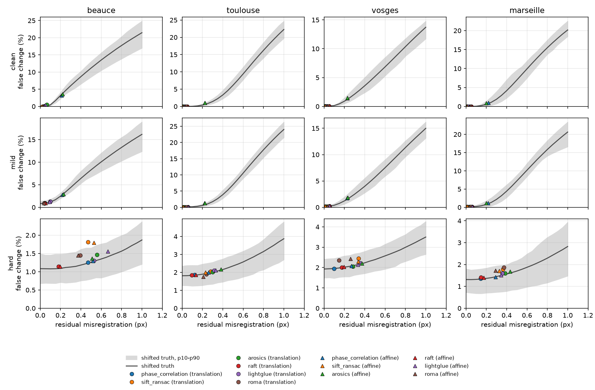

# Evaluation

Two results tables. **N2**, the current one, sets the classic methods against
pretrained deep-learning methods on four sites, on simulated pairs, inter-band
pairs, real triplets and through a change detector. **N1**, further down, is the
classic baseline it started from, on two sites. Every number comes from seeded
runs that the commands below reproduce.

## N2: classic against pretrained methods

### What was run

- **Sites.** Beauce (open fields), Toulouse (urban), Vosges (forest) and
  Marseille (coast): one clear Sentinel-2 L2A chip each, 1024 × 1024 px at 10 m
  ([`configs/sites.toml`](../configs/sites.toml)). **The two held-out sites,
  `alps` and `libya4`, are in no table of this page**: they are kept for the
  final evaluation, and every run's `context.json` lists the held-out sites it
  read: none.
- **Methods.** Four classic ones on the M1's CPU: `phase_correlation`,
  `phase_correlation_hann`, `sift_ransac`, `arosics`. Six pretrained ones, used
  as published, with no training on this data: `raft` and `raft_small`
  (torchvision optical flow), `lightglue` on ALIKED keypoints and
  `lightglue_disk` on DISK keypoints (affine fit by RANSAC), `roma` (RoMa's
  dense warp, affine fit by RANSAC) and `roma_dense` (the warp at every pixel).
  Parameters are in [`configs/methods.toml`](../configs/methods.toml).
- **Simulated pairs.** 100 windows of 256 × 256 px per site, B04, each run as a
  **translation** (up to ±4 px per axis), a small **affine** motion on top of it
  (as in N1) and a **dense** field on top of that (a smooth random field, up to
  0.8 px, 64 px correlation length), under the `clean`, `mild` and `hard`
  presets. 4 sites × 3 scenarios × 3 presets × 100 = 3,600 pairs. **Every cell
  is 100 pairs**, the same windows and displacements across scenarios, presets
  and methods.
- **Inter-band pairs.** Red against near infrared (B04/B08), with red against
  green (B04/B03) as the control, on Beauce and Toulouse, translation only:
  2 sites × 2 band pairs × 3 presets × **50 pairs a cell** = 600 pairs.
- **Real triplets (cycle consistency).** Each site has four dates: the chip's,
  one within 15 days of it, one a season later and one a year later
  ([`configs/real.toml`](../configs/real.toml)). There is no ground truth, so
  the score is the closure: registering A to B, then B to C, should give what
  registering A to C gives. 16 windows × 4 triplets = **64 triplets per site and
  method**, plus 5 simulated triplets per site, scenario and preset, where the
  truth is known.
- **False change.** One fixed change detector (a threshold at 3 σ of the pair's
  noise) counts the unchanged pixels it flags after each method's correction:
  **20 simulated pairs per cell** (translation and affine), and 96 real windows
  per site, counted on stable ground (built-up and bare ground in ESA
  WorldCover).

Cycle consistency and false change run six methods: phase correlation, SIFT,
AROSICS, RAFT, LightGlue and RoMa's affine fit.

A method **fails** a pair as in N1: it declines it, crashes, or is off by more
than 1 px on average. **The mean EPE is over the pairs a method did not fail.**
A triplet fails if one of its legs fails or if its closure exceeds 1 px.

### How to reproduce it

The deep-learning methods' accuracy comes from a GPU, the rest from the M1.
`make n2` runs the M1 part and merges the GPU part:

```bash
satreg benchmark --config configs/n2.toml            # M1, CPU     -> outputs/n2-m1
satreg benchmark --config configs/n2-gpu.toml        # Kaggle, T4  -> outputs/n2-gpu
satreg merge outputs/n2-m1 outputs/kaggle/outputs/n2-gpu --out outputs/n2
satreg benchmark --config configs/n2-cost.toml       # M1, CPU     -> outputs/n2-cost
satreg benchmark --config configs/n2-bands.toml      # M1, CPU     -> outputs/n2-bands-m1
satreg benchmark --config configs/n2-bands-gpu.toml  # Kaggle, T4  -> outputs/n2-bands-gpu
satreg merge outputs/n2-bands-m1 outputs/kaggle/outputs/n2-bands-gpu --out outputs/n2-bands
satreg cycle --config configs/n2.toml                # M1          -> outputs/n2-cycle
satreg false-change --config configs/n2.toml         # M1          -> outputs/n2-false-change
```

The two GPU runs are made first, with the Kaggle notebook, and downloaded to
`outputs/kaggle/outputs/` ([`kaggle.md`](kaggle.md)). The M1 part needs the
`[dl]` extra, AROSICS and RoMa (`make install-dl install-arosics install-roma`,
see the README).

| run | config | device | pairs | duration |
|---|---|---|---:|---:|
| simulated, classic | [`n2.toml`](../configs/n2.toml) `[benchmark]` | M1 CPU | 3,600 × 4 methods | 14 min |
| simulated, pretrained | [`n2-gpu.toml`](../configs/n2-gpu.toml) | Kaggle T4 | 3,600 × 6 methods | 125 min |
| CPU cost, pretrained | [`n2-cost.toml`](../configs/n2-cost.toml) | M1 CPU | 360 × 4 methods | 32 min |
| inter-band, classic | [`n2-bands.toml`](../configs/n2-bands.toml) | M1 CPU | 600 × 4 methods | 2 min |
| inter-band, pretrained | [`n2-bands-gpu.toml`](../configs/n2-bands-gpu.toml) | Kaggle T4 | 600 × 6 methods | 20 min |
| cycle consistency | [`n2.toml`](../configs/n2.toml) `[cycle]` | M1 CPU | 256 real + 180 simulated triplets × 6 methods | 148 min |
| false change | [`n2.toml`](../configs/n2.toml) `[false_change]` | M1 CPU | 480 simulated pairs + 384 real windows × 6 methods | 133 min |

About 5 h 30 on the M1 and 2 h 25 on a T4. The simulated table's GPU half was
made from commit `7505bcd`, and every other run from `a0999e2`; no file under
`src/` differs between the two commits. All seeds are 0. A test checks that the
M1 and GPU configs ask for the same pairs. On the classic rows a rerun gives the
same accuracy; LightGlue and RoMa can move slightly on hard pairs between
devices, by RANSAC's sampling order
([`failures.md`](failures.md), 2026-09-25).

The run's own tables and contexts are copied in
[`results/n2/`](results/n2/): one row per site, scenario, preset and method
(`simulated.md`, `bands.md`, `cost-m1.md`, `cycle.md`, `false-change.md`), and
each run's `context.json` (machine, library versions, commit, every option).

### Hardware

| | M1 (classic methods, cost, cycle, false change) | Kaggle (pretrained methods' accuracy) |
|---|---|---|
| Machine | Apple M1, 8 CPUs, 8 GiB, macOS 26.6.2 | Intel Xeon 2.00 GHz, 4 CPUs, 31 GiB, Linux |
| GPU | not used (CPU only) | one Tesla T4 of the session's two, 15 GiB, CUDA 12.8 |
| Threads | OpenCV on 8; PyTorch on 4 in the runs that load it (cost, cycle, false change) | OpenCV on 4, PyTorch on 2 |
| Python | 3.13.7 | 3.12.13 |
| PyTorch | torch 2.14.0, torchvision 0.29.0 | torch 2.10.0+cu128, torchvision 0.25.0+cu128 |
| Libraries | numpy 2.5.3, scipy 1.18.1, scikit-image 0.26.0, opencv-python-headless 5.0.0.93, rasterio 1.5.1, arosics 1.13.2, GDAL 3.13.3 | numpy 2.0.2, scipy 1.16.3, scikit-image 0.25.2, opencv-python-headless 4.13.0.92, rasterio 1.5.0, GDAL 3.8.4 |
| Process peak memory | 0.5 GiB (classic) to 4.0 GiB (cycle, with RoMa) | 4.1 to 4.2 GiB |

On CUDA, RoMa computes in half precision; on the M1's CPU, in float32.

### Results: simulated pairs

Mean end-point error in pixels over the pairs a method did not fail, averaged
over the four sites; the failure rate is in brackets when it is not zero. 400
pairs per cell (100 per site). In bold, the lowest error among the methods that
fail at most 5 % of the pairs.

| scenario | preset | phase corr. | + Hann | SIFT | AROSICS | RAFT | RAFT small | LightGlue | LG DISK | RoMa | RoMa dense |
|---|---|---:|---:|---:|---:|---:|---:|---:|---:|---:|---:|
| translation | clean | 0.014 | **0.004** | 0.012 | 0.027 | 0.047 | 0.131 | 0.033 | 0.129 | 0.040 | 0.052 |
| translation | mild | 0.019 | **0.007** | 0.024 | 0.047 | 0.061 | 0.158 (1 %) | 0.064 | 0.143 | 0.041 | 0.073 |
| translation | hard | **0.191** (1 %) | 0.270 (4 %) | 0.396 (36 %) | 0.330 (34 %) | 0.192 (2 %) | 0.428 (22 %) | 0.434 (15 %) | 0.482 (24 %) | 0.382 (68 %) | 0.783 (98 %) |
| affine | clean | 0.229 | 0.224 | **0.012** | 0.227 (1 %) | 0.054 | 0.135 | 0.034 | 0.140 | 0.034 | 0.050 |
| affine | mild | 0.230 | 0.224 | **0.024** | 0.232 | 0.070 | 0.164 (1 %) | 0.065 | 0.170 | 0.035 | 0.071 |
| affine | hard | 0.322 (2 %) | 0.372 (3 %) | 0.399 (36 %) | 0.412 (32 %) | **0.221** (2 %) | 0.437 (22 %) | 0.436 (18 %) | 0.490 (22 %) | 0.357 (68 %) | 0.729 (98 %) |
| dense | clean | 0.290 | 0.295 | 0.133 | 0.293 (8 %) | 0.095 | 0.169 | 0.140 | 0.213 | 0.140 | **0.053** |
| dense | mild | 0.291 | 0.295 | 0.137 | 0.297 (7 %) | 0.114 | 0.197 | 0.156 | 0.235 | 0.140 | **0.069** |
| dense | hard | 0.369 (2 %) | 0.421 (4 %) | 0.423 (36 %) | 0.432 (35 %) | **0.257** (2 %) | 0.447 (20 %) | 0.444 (16 %) | 0.519 (21 %) | 0.394 (69 %) | 0.682 (92 %) |

`hard` is where the sites differ most. Per site, 100 pairs a cell:

| site | scenario | phase corr. | + Hann | SIFT | AROSICS | RAFT | RAFT small | LightGlue | LG DISK | RoMa | RoMa dense |
|---|---|---:|---:|---:|---:|---:|---:|---:|---:|---:|---:|
| Beauce | translation, hard | 0.407 (4 %) | 0.450 (13 %) | 0.560 (76 %) | 0.400 (50 %) | **0.236** (4 %) | 0.479 (14 %) | 0.593 (49 %) | 0.546 (54 %) | 0.447 (48 %) | 0.781 (92 %) |
| Toulouse | translation, hard | **0.100** | 0.183 | 0.279 (11 %) | 0.303 (22 %) | 0.113 | 0.333 (1 %) | 0.334 (1 %) | 0.390 (4 %) | 0.362 (83 %) | n/a (100 %) |
| Vosges | translation, hard | **0.118** | 0.226 (1 %) | 0.403 (33 %) | 0.308 (30 %) | 0.225 | 0.523 (46 %) | 0.417 (5 %) | 0.565 (27 %) | 0.390 (81 %) | 0.935 (99 %) |
| Marseille | translation, hard | **0.138** | 0.222 (1 %) | 0.340 (22 %) | 0.310 (32 %) | 0.194 (5 %) | 0.378 (26 %) | 0.391 (5 %) | 0.426 (9 %) | 0.329 (61 %) | 0.635 (99 %) |
| Beauce | dense, hard | 0.515 (9 %) | 0.534 (15 %) | 0.533 (75 %) | 0.484 (48 %) | **0.291** (2 %) | 0.488 (13 %) | 0.574 (47 %) | 0.639 (49 %) | 0.492 (50 %) | 0.674 (76 %) |
| Toulouse | dense, hard | 0.303 | 0.361 | 0.322 (12 %) | 0.415 (25 %) | **0.189** | 0.366 | 0.367 (1 %) | 0.426 (2 %) | 0.315 (84 %) | 0.958 (99 %) |
| Vosges | dense, hard | 0.329 | 0.402 | 0.423 (35 %) | 0.410 (39 %) | **0.287** | 0.541 (44 %) | 0.429 (9 %) | 0.561 (21 %) | 0.377 (80 %) | 0.517 (97 %) |
| Marseille | dense, hard | **0.331** | 0.386 (1 %) | 0.414 (21 %) | 0.419 (29 %) | 0.263 (6 %) | 0.393 (25 %) | 0.405 (9 %) | 0.448 (11 %) | 0.393 (63 %) | 0.577 (96 %) |

A failure is either a pair the method declined or one it got wrong by more than
1 px without saying so. Over the 1,200 `hard` pairs of each method:

| method | declined | off by more than 1 px |
|---|---:|---:|
| phase corr. | 0 % | 2 % |
| + Hann | 0 % | 4 % |
| SIFT | 27 % | 9 % |
| AROSICS | 33 % | 0.5 % |
| RAFT | 0 % | 2 % |
| RAFT small | 0 % | 21 % |
| LightGlue | 6 % | 11 % |
| LG DISK | 2 % | 20 % |
| RoMa | 64 % | 5 % |
| RoMa dense | 64 % | 32 % |

### Results: cost

Median time and peak memory of one call on a 256 × 256 px pair, each call timed
as the median of 3 after one warm-up call. A row is the median over the cells
(site, scenario, preset) of each cell's median. The classic rows are the 3,600 pairs
of the M1 run; the pretrained rows on the M1 are the first 10 pairs of each cell
(360 pairs); the T4 columns are the 3,600 pairs of the GPU run.

| method | M1 CPU time | M1 memory | T4 time | T4 memory |
|---|---:|---:|---:|---:|
| phase corr. | 3.6 ms | 6.5 MiB | n/a | n/a |
| + Hann | 5.8 ms | 8.0 MiB | n/a | n/a |
| SIFT | 17.2 ms | 1.9 MiB | n/a | n/a |
| AROSICS | 16.8 ms | 10.0 MiB | n/a | n/a |
| RAFT | 367 ms | 106 MiB | 47.5 ms | 43.5 MiB |
| RAFT small | 104 ms | 25.0 MiB | 31.9 ms | 20.5 MiB |
| LightGlue | 198 ms | 99.6 MiB | 42.8 ms | 100 MiB |
| LG DISK | 536 ms | 600 MiB | 45.1 ms | 101 MiB |
| RoMa | 2,955 ms | 438 MiB | 150 ms | 400 MiB |
| RoMa dense | n/a | n/a | 148 ms | 400 MiB |

RoMa's M1 row comes from the cycle-consistency run (one call per leg, timed
once): it was left out of the cost run, where it swaps next to the other
networks on 8 GiB. Memory is not one measure: `tracemalloc` for the classic
methods (it misses native allocations), PyTorch's CPU profiler on the M1, the
peak held by CUDA tensors on the T4. Weights are not counted in the time: about
120 MB to download for RAFT and LightGlue, 1.7 GB for RoMa.

### Results: across spectral bands

Translation pairs whose two images are different bands of the same scene. Mean
of Beauce and Toulouse, 50 pairs per site and cell. The B04/B04 rows are the
same cells of the simulated table (100 pairs per site), for comparison.

| bands | preset | phase corr. | + Hann | SIFT | AROSICS | RAFT | RAFT small | LightGlue | LG DISK | RoMa | RoMa dense |
|---|---|---:|---:|---:|---:|---:|---:|---:|---:|---:|---:|
| B04/B04 (100 pairs) | clean | 0.018 | **0.004** | 0.014 | 0.038 | 0.045 | 0.130 | 0.033 | 0.137 | 0.038 | 0.050 |
| B04/B04 (100 pairs) | mild | 0.027 | **0.009** | 0.028 | 0.062 | 0.067 (1 %) | 0.159 | 0.072 | 0.155 | 0.041 | 0.078 |
| B04/B04 (100 pairs) | hard | 0.254 (2 %) | 0.317 (6 %) | 0.419 (44 %) | 0.351 (36 %) | **0.175** (2 %) | 0.406 (8 %) | 0.464 (25 %) | 0.468 (29 %) | 0.405 (66 %) | 0.781 (96 %) |
| B04/B03 | clean | 0.057 | 0.058 | 0.089 | 0.090 | 0.094 | 0.203 | 0.125 | 0.192 | **0.053** | 0.096 |
| B04/B03 | mild | 0.051 | **0.048** | 0.098 | 0.102 | 0.104 (3 %) | 0.232 (1 %) | 0.142 | 0.201 | 0.055 | 0.115 |
| B04/B03 | hard | 0.226 | 0.322 (9 %) | 0.538 (69 %) | 0.335 (39 %) | **0.211** (4 %) | 0.533 (17 %) | 0.542 (33 %) | 0.590 (40 %) | 0.455 (76 %) | 0.854 (99 %) |
| B04/B08 | clean | 0.274 (11 %) | 0.317 (23 %) | 0.502 (78 %) | 0.428 (41 %) | 0.634 (80 %) | 0.953 (99 %) | 0.529 (54 %) | 0.442 (52 %) | 0.115 (15 %) | 0.345 (30 %) |
| B04/B08 | mild | 0.265 (16 %) | 0.303 (22 %) | 0.277 (94 %) | 0.393 (45 %) | 0.642 (85 %) | 0.866 (97 %) | 0.604 (66 %) | 0.444 (50 %) | 0.159 (20 %) | 0.434 (37 %) |
| B04/B08 | hard | 0.465 (62 %) | 0.522 (78 %) | n/a (100 %) | 0.464 (97 %) | 0.785 (86 %) | 0.876 (98 %) | n/a (100 %) | 0.422 (99 %) | n/a (100 %) | n/a (100 %) |

### Results: cycle consistency on real triplets

Mean closure in pixels over the triplets a method did not fail, failure rate in
brackets. 64 triplets per site: 16 windows × 4 triplets of dates. In bold, the
lowest closure among the methods that fail at most 5 % of the triplets.

| site | phase corr. | SIFT | AROSICS | RAFT | LightGlue | RoMa |
|---|---:|---:|---:|---:|---:|---:|
| Beauce (64) | **0.087** | 0.562 (67 %) | 0.252 | 0.678 (95 %) | 0.551 (62 %) | 0.218 (6 %) |
| Toulouse (64) | 0.084 | 0.125 | 0.217 | 0.088 (3 %) | 0.185 | **0.048** |
| Vosges (64) | **0.091** | 0.147 (73 %) | 0.276 | 0.327 (12 %) | 0.282 (61 %) | 0.139 (67 %) |
| Marseille (64) | **0.058** | 0.120 (12 %) | 0.175 | 0.040 (25 %) | 0.200 (11 %) | 0.083 (11 %) |
| All (256) | **0.080** | 0.184 (38 %) | 0.230 | 0.164 (34 %) | 0.256 (34 %) | 0.118 (21 %) |

**A closure is not an accuracy.** It measures whether three estimates agree, and
a method that makes the same error on every leg closes well. The simulated
triplets, where the truth is known, show how far apart the two can be. Mean
closure / mean true error of the legs, in pixels. Each cell is the mean over
four sites and three presets of the mean over the triplets a method did not
fail, 5 triplets per site and preset (60 per cell), so these are orders of
magnitude:

| scenario | phase corr. | SIFT | AROSICS | RAFT | LightGlue | RoMa |
|---|---:|---:|---:|---:|---:|---:|
| translation | 0.14 / 0.08 | 0.17 / 0.09 | 0.13 / 0.07 | 0.23 / 0.12 | 0.19 / 0.14 | 0.06 / 0.04 |
| affine | 0.15 / 0.26 | 0.07 / 0.06 | 0.14 / 0.24 | 0.23 / 0.14 | 0.19 / 0.14 | 0.12 / 0.08 |
| dense | 0.18 / 0.35 | 0.15 / 0.22 | 0.15 / 0.33 | 0.23 / 0.18 | 0.23 / 0.25 | 0.17 / 0.20 |

On affine and dense motion, phase correlation and AROSICS close at 0.14 to
0.18 px while their true error is 0.24 to 0.35 px: a translation composed with a
translation
is still a translation. A good closure is necessary, not sufficient.

### Results: false change

The detector's false-change rate on simulated pairs as a function of the
registration residual. The "shifted truth" curve applies the true motion plus a
shift of the given size; at 0 px it is the floor that the preset's noise, blur
and radiometry leave with a perfect registration. Mean of the four sites, and
the `clean` preset per site:

| pairs \ residual | 0 px | 0.1 px | 0.2 px | 0.3 px | 0.5 px | 1.0 px |
|---|---:|---:|---:|---:|---:|---:|
| clean, four sites | 0.01 % | 0.17 % | 1.26 % | 2.87 % | 7.36 % | 19.40 % |
| mild, four sites | 0.30 % | 0.49 % | 1.27 % | 2.70 % | 7.05 % | 18.95 % |
| hard, four sites | 1.53 % | 1.55 % | 1.59 % | 1.67 % | 1.93 % | 3.02 % |
| clean, Beauce | 0.00 % | 0.45 % | 3.19 % | 6.04 % | 11.17 % | 21.46 % |
| clean, Toulouse | 0.00 % | 0.03 % | 0.40 % | 1.42 % | 6.12 % | 22.26 % |
| clean, Vosges | 0.04 % | 0.15 % | 0.91 % | 2.13 % | 5.18 % | 13.72 % |
| clean, Marseille | 0.00 % | 0.05 % | 0.55 % | 1.89 % | 6.96 % | 20.17 % |



*Grey: the curve and its 10th to 90th percentile band. Markers: each method's
mean residual and false-change rate, circles for translation pairs, triangles
for affine pairs.*

The same rate after each method's correction, mean of the four sites, 80 pairs
per cell. Failed pairs are left out of a method's mean; "no correction" is the
uncorrected pair.

| scenario | preset | no correction | phase corr. | SIFT | AROSICS | RAFT | LightGlue | RoMa |
|---|---|---:|---:|---:|---:|---:|---:|---:|
| translation | clean | 34.02 % | 0.01 % | 0.01 % | 0.14 % | 0.02 % | 0.05 % | 0.02 % |
| translation | mild | 33.76 % | 0.33 % | 0.32 % | 0.43 % | 0.36 % | 0.45 % | 0.34 % |
| translation | hard | 7.94 % | 1.60 % | 2.02 % | 1.78 % | 1.60 % | 1.81 % | 1.89 % |
| affine | clean | 34.00 % | 1.66 % | 0.01 % | 1.75 % | 0.04 % | 0.03 % | 0.02 % |
| affine | mild | 33.75 % | 1.77 % | 0.33 % | 1.83 % | 0.39 % | 0.44 % | 0.33 % |
| affine | hard | 7.97 % | 1.70 % | 1.95 % | 1.85 % | 1.61 % | 1.83 % | 1.84 % |

On real pairs, share of stable-ground pixels flagged as changed, 96 windows per
site (16 windows × 6 pairs of dates), pixels pooled over the windows; in
brackets, the windows a method declined, which are left out of its count. Only
Toulouse (40.6 % of the chip is stable ground) and Marseille (8.8 %) have enough
of it, and the rows per pair of dates pool these two sites. Beauce (0.6 %) and
Vosges (0.1 %) are in [`results/n2/false-change.md`](results/n2/false-change.md):
the detector flags most of their few stable pixels whatever the method
([`decisions.md`](decisions.md), 2026-09-28).

| site / pair | windows | no correction | phase corr. | SIFT | AROSICS | RAFT | LightGlue | RoMa |
|---|---:|---:|---:|---:|---:|---:|---:|---:|
| Toulouse, all pairs | 96 | 13.7 % | 11.3 % | 11.5 % | 12.2 % | 11.5 % | 11.9 % | 11.3 % |
| Marseille, all pairs | 96 | 11.0 % | 10.1 % | 10.2 % (2) | 10.7 % | 10.1 % | 10.9 % (2) | 10.2 % (3) |
| both sites, anchor-days | 32 | 3.0 % | 2.9 % | 2.9 % | 4.7 % | 2.9 % | 3.0 % | 2.9 % |
| both sites, anchor-season | 32 | 18.4 % | 14.6 % | 14.9 % (1) | 15.0 % | 15.0 % | 15.6 % (1) | 14.6 % |
| both sites, anchor-year | 32 | 7.3 % | 7.1 % | 7.1 % | 7.9 % | 7.2 % | 7.2 % | 7.1 % |
| both sites, days-season | 32 | 17.1 % | 12.9 % | 13.2 % | 13.3 % | 13.3 % | 13.8 % | 13.0 % (2) |
| both sites, days-year | 32 | 10.6 % | 10.1 % | 10.1 % | 11.3 % | 10.2 % | 10.4 % | 10.1 % |
| both sites, season-year | 32 | 23.0 % | 18.8 % | 19.3 % (1) | 19.6 % | 19.1 % | 20.3 % (1) | 18.9 % (1) |

### Reading the tables

**Where AI wins: motion that no global model describes, and pairs that do not
look alike.** On dense fields, two pretrained methods are the only ones under
0.1 px on clean pairs: RoMa's dense output at 0.053 px and RAFT at 0.095 px,
against 0.133 px for SIFT and 0.29 px for the translation-only methods. Across
spectral bands, red against near infrared, RoMa is the only method that holds:
0.115 px with 15 % of failures on clean pairs, where phase correlation is at
0.27 px and SIFT and RAFT fail four pairs in five. Under the `hard` preset, RAFT
is the one pretrained method as robust as phase correlation, 2 % of failures, and
it is more accurate on affine and dense motion (0.22 and 0.26 px against 0.32 and
0.37 px).

**Where it does not: global motion on clean pairs, and real pairs whose ground
changes.** On clean translations the Hann-windowed phase correlation is at
0.004 px and the best pretrained method, LightGlue, at 0.033 px. On clean affine
pairs SIFT keeps the lead, 0.012 px against 0.034 px for RoMa and LightGlue. No
pretrained method is the best everywhere: RAFT, the most robust on `hard`, fails
80 % of clean red/near-infrared pairs and 95 % of the real Beauce triplets, where
RoMa fails 6 %; RoMa declines 64 % of `hard` pairs. On real multi-temporal
triplets, plain phase correlation closes every triplet, at 0.08 px. A pretrained
method closes tighter on two sites only: RoMa on Toulouse (0.05 px, no failure),
whose stable urban ground lets all six methods close nearly every triplet, and
RAFT on Marseille (0.04 px), where it fails a quarter of the triplets. The small
pretrained variants do not pay: RAFT small and LightGlue on DISK are two and a
half to four times less accurate than their larger versions on clean translation
and affine pairs.

**What it costs, and what the accuracy buys.** On the M1's CPU, RAFT takes about
370 ms a pair and RoMa about 3 s, against 3.6 ms for phase correlation: a hundred
and eight hundred times more. A T4 brings them to 48 and 150 ms. The false-change
curve says what a residual is worth: on clean pairs, 0.1 px of residual flags
0.17 % of unchanged pixels as changed, 0.3 px flags 2.9 %, and 0.5 px flags 7.4 %,
and more on Beauce's fields than on Toulouse (6.0 % against 1.4 % at 0.3 px). So
following an affine motion, by SIFT or by a pretrained method, cuts false changes
from 1.7 % to under 0.05 % on clean pairs. On `hard` pairs the floor left by
noise, blur and radiometry is already 1.5 % with a perfect registration, and
every method lands between 1.6 and 2.0 %: there, registration is no longer what
limits change detection. On real pairs over stable ground, the best correction
lowers the flagged share from 13.7 % to 11.3 % on Toulouse, mostly on pairs a
season apart.

### Limits

What N2 lifted from the N1 limits:

- **One scene per site.** Each site now has four dates, and the real triplets
  and real false-change counts use them. The simulated table still cuts its 100
  windows from one chip per site, but over four sites instead of two.
- **Global motion only.** The dense scenario adds a spatially varying field.
- **One band.** The inter-band table registers B04 against B08 and B03.

What remains:

- **Pretrained means untrained here.** No network saw Sentinel-2 data from this
  project. The table says what published weights do out of the box, not what
  the architectures can do; fine-tuning is N3.
- **The dense field is one family.** A smooth random field of at most 0.8 px
  with a 64 px correlation length: no terrain parallax, no discontinuity.
- **No ground truth on real pairs.** Closure and false change on stable ground
  are indirect: closure misses a bias common to the three legs, and "stable"
  ground still changes (shadows, roofs, a 2021 land-cover map). Two of the four
  sites have too little stable ground to count.
- **Inter-band truth holds to about 0.1 px.** The B04/B08 co-registration of
  the product was checked on these two scenes only
  ([`decisions.md`](decisions.md)), so differences under 0.1 px in that table
  mean nothing, and no other site is in it.
- **Small cells outside the main table.** 50 pairs a cell across bands
  (±7 points on a failure rate, one standard error at most), 20 for false
  change, 16 windows per site and triplet for closure, where one site's
  triplets share their three dates and are not independent.
- **Two machines.** Accuracy of the pretrained rows comes from a T4, in half
  precision for RoMa, their M1 cost from 10 pairs a cell, and RoMa's from
  another run. RoMa's `hard` failure rates per site on the T4 match those of the
  false-change run on the M1's CPU to a few pairs in twenty
  ([`failures.md`](failures.md), 2026-10-01), but the two devices were not
  compared pair by pair on this table.
- **Four sites, all in France.** The held-out sites (a mountain and a desert)
  are not in these tables, by design.
- **Uncertainty and cost on one laptop**, as in N1 below.

## N1: the classic baseline

The first results table of the project: the three classic methods, and two
variants, on simulated displacements of two Sentinel-2 chips, from clean pairs to
hard ones. Everything here comes from one seeded run, which the command below
reproduces.

### What was run

- **Sites.** Beauce (open fields, low texture) and Toulouse (urban, dense texture):
  one least-cloudy Sentinel-2 L2A B04 chip each, 1024 × 1024 px at 10 m (see
  [`configs/sites.toml`](../configs/sites.toml)).
- **Pairs.** 100 windows of 256 × 256 px per site, each with a random sub-pixel
  shift of up to ±4 px per axis. Each pair is run twice: as a pure **translation**,
  and as a small **affine** motion (up to ±0.2° rotation, ±0.2 % scale change,
  ±0.002 shear) about the same centre, on top of the same shift.
- **Presets.** Each pair is run `clean`, `mild` and `hard` (noise, blur, a
  radiometric difference and procedural clouds, at increasing strength; see
  [`configs/degradations.toml`](../configs/degradations.toml)). The geometry does
  not change, so the ground truth stays exact.
- **Methods.** `phase_correlation` (scikit-image, unwindowed), `sift_ransac`
  (OpenCV) and `arosics` (AROSICS `COREG`, reliability floor 40 %), plus two
  variants: `phase_correlation_hann`, with a Hann window, and `arosics_floor60`,
  with AROSICS' earlier 60 % floor. The variants are there to settle two choices,
  recorded in [`decisions.md`](decisions.md).
- **Size.** 2 sites × 2 scenarios × 3 presets × 100 pairs = 1,200 simulated pairs,
  × 5 methods = 6,000 rows. **Every cell of the table is 100 pairs**, the same 100
  windows and displacements across scenarios, presets and methods.

A method **fails** a pair when it declines it (too few SIFT inliers, no AROSICS
match or a reliability under the floor), crashes, or is off by more than 1 px on
average. **The mean EPE is over the pairs a method did not fail**, so a method
that declines hard pairs can show a low error on the ones it kept: read it with
the failure rate, or with the share under 0.3 px below, which counts every
failure as a miss.

### How to reproduce it

```bash
satreg benchmark --config configs/n1.toml
```

AROSICS must be installed (`make install-arosics`, see the README). A missing chip
is fetched on the first run (about 1.5 MB per site) and cached in `data/chips/`,
and `make n1` runs the same command. The run takes
about 5 min 30 s on the machine below and writes `outputs/n1/`: `pairs.csv` (one
row per pair and method, with the truth, the estimate, each method's diagnostics
and its cost), `summary.csv` and `summary.md` (the table at the end of this page),
and `context.json` (the machine, the library versions and every option of the
run). Pair geometry depends only on the seed, the site and the pair index, so a
rerun gives the same accuracy figures; times move by about 1 %.

The config, [`configs/n1.toml`](../configs/n1.toml):

```toml
[benchmark]
sites = ["beauce", "toulouse"]
scenarios = ["translation", "affine"]
degradations = ["clean", "mild", "hard"]
methods = [
    "phase_correlation",
    "phase_correlation_hann",
    "sift_ransac",
    "arosics",
    "arosics_floor60",
]

pairs = 100
size = 256
seed = 0

max_shift = 4.0
max_rotation = 0.2
max_scale_change = 0.002
max_shear = 0.002

failure_threshold = 1.0
warmup = 1
repeats = 3

sites_config = "configs/sites.toml"
degradations_config = "configs/degradations.toml"
methods_config = "configs/methods.toml"
data_dir = "data"
out = "outputs/n1"
```

The method parameters and the two variants are in
[`configs/methods.toml`](../configs/methods.toml).

### Hardware

| | |
|---|---|
| Machine | Apple M1, 8 CPUs, 8 GiB, macOS 26.6.2 (arm64) |
| Threads | no thread variable set; OpenCV on 8 threads |
| Python | 3.13.7 |
| Libraries | numpy 2.5.3, scipy 1.18.1, scikit-image 0.26.0, opencv-python-headless 5.0.0.93, rasterio 1.5.1, arosics 1.13.2, GDAL 3.13.3 |
| Process peak memory | 317 MiB for the whole run |

### Results

Mean end-point error in pixels, over the pairs a method did not fail; the failure
rate is in brackets when it is not zero. 100 pairs per cell.

| site | scenario | preset | phase correlation | phase corr. + Hann | SIFT + RANSAC | AROSICS | AROSICS, 60 % floor |
|---|---|---|---:|---:|---:|---:|---:|
| Beauce | translation | clean | 0.026 | **0.004** | 0.022 | 0.061 | 0.061 |
| Beauce | translation | mild | 0.043 | **0.013** | 0.046 | 0.096 | 0.096 |
| Beauce | translation | hard | 0.407 (4 %) | 0.450 (13 %) | 0.560 (76 %) | 0.400 (50 %) | 0.421 (78 %) |
| Beauce | affine | clean | 0.229 | 0.223 | **0.021** | 0.234 (1 %) | 0.234 (1 %) |
| Beauce | affine | mild | 0.233 | 0.223 | **0.046** | 0.246 | 0.246 |
| Beauce | affine | hard | 0.479 (6 %) | 0.516 (12 %) | 0.520 (76 %) | 0.494 (47 %) | 0.476 (76 %) |
| Toulouse | translation | clean | 0.010 | **0.004** | 0.006 | 0.016 | 0.016 |
| Toulouse | translation | mild | 0.010 | **0.005** | 0.009 | 0.027 | 0.027 |
| Toulouse | translation | hard | **0.100** | 0.183 | 0.279 (11 %) | 0.303 (22 %) | 0.307 (41 %) |
| Toulouse | affine | clean | 0.220 | 0.220 | **0.005** | 0.220 | 0.220 |
| Toulouse | affine | mild | 0.221 | 0.220 | **0.009** | 0.223 | 0.223 |
| Toulouse | affine | hard | **0.253** | 0.298 | 0.289 (12 %) | 0.392 (21 %) | 0.382 (40 %) |

On `hard` pairs the mean error alone is misleading, because each method is
averaged over a different subset. The share of the 100 pairs registered to better
than 0.3 px (the Sentinel-2 co-registration requirement), counting every failure
as a miss:

| site | scenario | phase correlation | phase corr. + Hann | SIFT + RANSAC | AROSICS | AROSICS, 60 % floor |
|---|---|---:|---:|---:|---:|---:|
| Beauce | translation, hard | **38 %** | 26 % | 6 % | 21 % | 8 % |
| Beauce | affine, hard | **21 %** | 16 % | 4 % | 9 % | 5 % |
| Toulouse | translation, hard | **98 %** | 85 % | 62 % | 35 % | 23 % |
| Toulouse | affine, hard | **74 %** | 58 % | 57 % | 17 % | 14 % |
| both | affine, clean | 75–78 % | 78 % | **100 %** | 74–78 % | 74–78 % |

Every method registers every clean and mild translation pair under 0.3 px.

#### Cost

Median over the 600 calls per site (all scenarios and presets), each call timed
as the median of 3 after one warm-up call.

| method | time, Beauce | time, Toulouse | traced memory |
|---|---:|---:|---:|
| phase correlation | 3.6 ms | 3.6 ms | 6.5 MiB |
| phase correlation + Hann | 5.8 ms | 5.8 ms | 8.0 MiB |
| SIFT + RANSAC | 14.1 ms | 24.9 ms | 1.7 / 2.2 MiB |
| AROSICS | 16.8 ms | 16.7 ms | 10.0 MiB |

`tracemalloc` only sees memory allocated through Python: SIFT's native buffers
are missed, and its real footprint is about nine times the figure shown (measured
in [`decisions.md`](decisions.md)). AROSICS' first call in a process takes about
2 s, which the warm-up call absorbs.

### Reading the table

**Clean and mild translations: every method is well inside the target.** The
worst mean error is 0.096 px. The Hann-windowed phase correlation is the most
accurate, at 0.004 px on both sites, because the window removes the border
discontinuity that biases the unwindowed version (0.026 px on Beauce). AROSICS is
the least accurate of the four, 0.06 px on clean Beauce, although it also
phase-correlates: its sub-pixel peak estimate is coarser than scikit-image's
upsampled one.

**Affine motion: only SIFT follows it.** Phase correlation and AROSICS estimate a
single translation, so a rotation or scale change of this size leaves them at a
floor of about 0.22 px, whatever the image quality: 0.220 px on clean Toulouse
for all three, with about one pair in five above 0.3 px. That floor is the motion
model, not the estimator. SIFT + RANSAC fits an affine transform and stays at
0.005 to 0.05 px, ten to forty times better, as long as it finds enough keypoints.

**Hard pairs: phase correlation is the most robust, and nothing is good on
Beauce.** Under clouds, blur and radiometric change, plain phase correlation never
declines, fails 4 to 6 % of Beauce pairs by a gross error and none of Toulouse,
and has the highest share under 0.3 px in every hard cell. SIFT and AROSICS break
the other way: they decline what they cannot match. On Beauce, SIFT declines three
pairs in four for lack of inliers, and AROSICS half of them. Even the best method
registers only 38 % of hard Beauce translations to 0.3 px; the degradations there
are beyond what any classic method handles, which is the gap the AI methods of
the next levels are measured against.

**The scene matters as much as the method.** Toulouse's urban texture gives SIFT
about four times more keypoints than Beauce's fields (1,291 against 313 at the
median, on clean pairs), and every method is better there: on hard translations,
phase correlation goes from 38 % to 98 % of pairs under 0.3 px, SIFT's failure
rate from 76 % to 11 %. A single-site table would have mixed up what belongs to
the method and what belongs to the ground.

**Where each method breaks.**

- **Phase correlation** breaks on any motion that is not a translation (the
  0.22 px floor), and on low-texture scenes under heavy cloud, where it fails
  without warning: it returns a shift for every pair, right or wrong.
- **Phase correlation + Hann** is the best on clean pairs and worse on hard ones.
  The window concentrates the correlation on the centre of the pair, and when a
  cloud bank sits there, it correlates the cloud: 13 % gross errors on hard
  Beauce translations against 4 %, some off by 50 px (see
  [`failures.md`](failures.md)).
- **SIFT + RANSAC** breaks on texture: on hard Beauce it declines 137 of 200
  pairs for too few inliers, and 15 of the ones it keeps are off by more than
  1 px. It is also the only method whose cost depends on the scene, 14 ms on
  Beauce and 25 ms on Toulouse.
- **AROSICS** breaks under clouds and blur by declining: on hard Beauce, 54 of
  200 pairs find no match and 43 rate under 40 % reliability. It never returned a
  gross error in this run: what it keeps, it keeps right. Once, it found no match
  on a clean pair, for no reason found yet (see [`failures.md`](failures.md)).

**The two open choices.** The Hann window does not replace the unwindowed
version: it wins clean and mild, loses hard, so both stay in the table and the
plain one stays the reference row. AROSICS' reliability floor drops from 60 to
40 %: the pairs rated between the two are as accurate as those above 60 %, and the
lower floor cuts AROSICS' failure rate on hard Beauce from 78 % to 50 % with no
added gross error. Both decisions are in [`decisions.md`](decisions.md).

### Limits

- **Simulated displacements.** The motion is exact because it is simulated on a
  single image. The presets approximate what separates two real acquisitions
  (noise, blur, radiometry, clouds), but not everything: no change on the ground,
  no parallax, no seasonal difference.
- **One scene per site, one band.** Each site is one B04 chip; 100 windows cut
  from it are not independent scenes. The site effect above rests on two chips.
- **Global motion only.** Translation and a small affine motion over 256 px.
  Dense, spatially varying fields come in N2, with the learned methods.
- **Uncertainty.** With 100 pairs per cell, a failure rate is known to about
  ±5 points (one standard error at most), enough for the differences discussed
  here, not for differences of a point or two.
- **Cost on one laptop.** Times are for one M1 and 256 px windows, with default
  thread settings; they compare methods on the same machine and say little about
  another. Memory is what `tracemalloc` sees.

### The full table

As written by the run to `outputs/n1/summary.md`. "clouds" is the mean share of
the moving image under cloud; "< 0.1 px" and "< 0.5 px" are shares of pixels,
over the pairs that did not fail.

| site | scenario | degradation | method | pairs | clouds | EPE (px) | < 0.1 px | < 0.5 px | failures | time (ms) | memory (MiB) |
|---|---|---|---|---:|---:|---:|---:|---:|---:|---:|---:|
| beauce | translation | clean | phase_correlation | 100 | 0.0 % | 0.0261 | 100.0 % | 100.0 % | 0.0 % | 3.6 | 6.5 |
| beauce | translation | clean | phase_correlation_hann | 100 | 0.0 % | 0.0043 | 100.0 % | 100.0 % | 0.0 % | 5.9 | 8.0 |
| beauce | translation | clean | sift_ransac | 100 | 0.0 % | 0.0220 | 99.8 % | 100.0 % | 0.0 % | 14.3 | 1.7 |
| beauce | translation | clean | arosics | 100 | 0.0 % | 0.0608 | 85.0 % | 100.0 % | 0.0 % | 17.0 | 10.0 |
| beauce | translation | clean | arosics_floor60 | 100 | 0.0 % | 0.0608 | 85.0 % | 100.0 % | 0.0 % | 17.0 | 10.0 |
| beauce | translation | mild | phase_correlation | 100 | 5.0 % | 0.0429 | 95.0 % | 100.0 % | 0.0 % | 3.6 | 6.5 |
| beauce | translation | mild | phase_correlation_hann | 100 | 5.0 % | 0.0126 | 100.0 % | 100.0 % | 0.0 % | 5.8 | 8.0 |
| beauce | translation | mild | sift_ransac | 100 | 5.0 % | 0.0461 | 93.3 % | 100.0 % | 0.0 % | 14.3 | 1.7 |
| beauce | translation | mild | arosics | 100 | 5.0 % | 0.0963 | 57.0 % | 100.0 % | 0.0 % | 16.7 | 10.0 |
| beauce | translation | mild | arosics_floor60 | 100 | 5.0 % | 0.0963 | 57.0 % | 100.0 % | 0.0 % | 16.7 | 10.0 |
| beauce | translation | hard | phase_correlation | 100 | 30.0 % | 0.4073 | 7.3 % | 70.8 % | 4.0 % | 3.6 | 6.5 |
| beauce | translation | hard | phase_correlation_hann | 100 | 30.0 % | 0.4503 | 8.0 % | 64.4 % | 13.0 % | 5.8 | 8.0 |
| beauce | translation | hard | sift_ransac | 100 | 30.0 % | 0.5595 | 7.6 % | 57.1 % | 76.0 % | 13.9 | 1.7 |
| beauce | translation | hard | arosics | 100 | 30.0 % | 0.3996 | 8.0 % | 72.0 % | 50.0 % | 16.7 | 10.0 |
| beauce | translation | hard | arosics_floor60 | 100 | 30.0 % | 0.4209 | 0.0 % | 77.3 % | 78.0 % | 16.6 | 10.0 |
| beauce | affine | clean | phase_correlation | 100 | 0.0 % | 0.2288 | 19.9 % | 95.0 % | 0.0 % | 3.6 | 6.5 |
| beauce | affine | clean | phase_correlation_hann | 100 | 0.0 % | 0.2225 | 20.7 % | 96.0 % | 0.0 % | 6.0 | 8.0 |
| beauce | affine | clean | sift_ransac | 100 | 0.0 % | 0.0209 | 99.9 % | 100.0 % | 0.0 % | 14.2 | 1.7 |
| beauce | affine | clean | arosics | 100 | 0.0 % | 0.2336 | 17.7 % | 94.9 % | 1.0 % | 17.0 | 10.0 |
| beauce | affine | clean | arosics_floor60 | 100 | 0.0 % | 0.2336 | 17.7 % | 94.9 % | 1.0 % | 16.9 | 10.0 |
| beauce | affine | mild | phase_correlation | 100 | 5.0 % | 0.2327 | 18.7 % | 94.5 % | 0.0 % | 3.6 | 6.5 |
| beauce | affine | mild | phase_correlation_hann | 100 | 5.0 % | 0.2228 | 20.5 % | 96.0 % | 0.0 % | 5.7 | 8.0 |
| beauce | affine | mild | sift_ransac | 100 | 5.0 % | 0.0463 | 93.0 % | 100.0 % | 0.0 % | 14.1 | 1.7 |
| beauce | affine | mild | arosics | 100 | 5.0 % | 0.2460 | 14.8 % | 94.2 % | 0.0 % | 16.7 | 10.0 |
| beauce | affine | mild | arosics_floor60 | 100 | 5.0 % | 0.2460 | 14.8 % | 94.2 % | 0.0 % | 16.7 | 10.0 |
| beauce | affine | hard | phase_correlation | 100 | 30.0 % | 0.4785 | 4.2 % | 57.3 % | 6.0 % | 3.6 | 6.5 |
| beauce | affine | hard | phase_correlation_hann | 100 | 30.0 % | 0.5162 | 4.2 % | 52.7 % | 12.0 % | 5.7 | 8.0 |
| beauce | affine | hard | sift_ransac | 100 | 30.0 % | 0.5197 | 6.8 % | 59.9 % | 76.0 % | 13.7 | 1.7 |
| beauce | affine | hard | arosics | 100 | 30.0 % | 0.4944 | 3.6 % | 56.8 % | 47.0 % | 16.7 | 10.0 |
| beauce | affine | hard | arosics_floor60 | 100 | 30.0 % | 0.4756 | 3.7 % | 61.7 % | 76.0 % | 16.6 | 10.0 |
| toulouse | translation | clean | phase_correlation | 100 | 0.0 % | 0.0095 | 100.0 % | 100.0 % | 0.0 % | 3.6 | 6.5 |
| toulouse | translation | clean | phase_correlation_hann | 100 | 0.0 % | 0.0040 | 100.0 % | 100.0 % | 0.0 % | 5.9 | 8.0 |
| toulouse | translation | clean | sift_ransac | 100 | 0.0 % | 0.0055 | 100.0 % | 100.0 % | 0.0 % | 25.7 | 2.2 |
| toulouse | translation | clean | arosics | 100 | 0.0 % | 0.0156 | 100.0 % | 100.0 % | 0.0 % | 17.0 | 10.0 |
| toulouse | translation | clean | arosics_floor60 | 100 | 0.0 % | 0.0156 | 100.0 % | 100.0 % | 0.0 % | 16.9 | 10.0 |
| toulouse | translation | mild | phase_correlation | 100 | 5.0 % | 0.0103 | 100.0 % | 100.0 % | 0.0 % | 3.6 | 6.5 |
| toulouse | translation | mild | phase_correlation_hann | 100 | 5.0 % | 0.0048 | 100.0 % | 100.0 % | 0.0 % | 5.7 | 8.0 |
| toulouse | translation | mild | sift_ransac | 100 | 5.0 % | 0.0090 | 100.0 % | 100.0 % | 0.0 % | 25.9 | 2.2 |
| toulouse | translation | mild | arosics | 100 | 5.0 % | 0.0267 | 100.0 % | 100.0 % | 0.0 % | 16.7 | 10.0 |
| toulouse | translation | mild | arosics_floor60 | 100 | 5.0 % | 0.0267 | 100.0 % | 100.0 % | 0.0 % | 16.6 | 10.0 |
| toulouse | translation | hard | phase_correlation | 100 | 30.0 % | 0.0997 | 59.0 % | 100.0 % | 0.0 % | 3.6 | 6.5 |
| toulouse | translation | hard | phase_correlation_hann | 100 | 30.0 % | 0.1833 | 32.0 % | 96.0 % | 0.0 % | 5.8 | 8.0 |
| toulouse | translation | hard | sift_ransac | 100 | 30.0 % | 0.2792 | 21.6 % | 86.7 % | 11.0 % | 17.6 | 2.1 |
| toulouse | translation | hard | arosics | 100 | 30.0 % | 0.3026 | 3.8 % | 97.4 % | 22.0 % | 16.7 | 10.0 |
| toulouse | translation | hard | arosics_floor60 | 100 | 30.0 % | 0.3069 | 5.1 % | 98.3 % | 41.0 % | 16.6 | 10.0 |
| toulouse | affine | clean | phase_correlation | 100 | 0.0 % | 0.2204 | 20.5 % | 96.2 % | 0.0 % | 3.6 | 6.5 |
| toulouse | affine | clean | phase_correlation_hann | 100 | 0.0 % | 0.2195 | 20.6 % | 96.3 % | 0.0 % | 6.0 | 8.0 |
| toulouse | affine | clean | sift_ransac | 100 | 0.0 % | 0.0054 | 100.0 % | 100.0 % | 0.0 % | 25.7 | 2.2 |
| toulouse | affine | clean | arosics | 100 | 0.0 % | 0.2204 | 20.5 % | 96.2 % | 0.0 % | 16.9 | 10.0 |
| toulouse | affine | clean | arosics_floor60 | 100 | 0.0 % | 0.2204 | 20.5 % | 96.2 % | 0.0 % | 16.9 | 10.0 |
| toulouse | affine | mild | phase_correlation | 100 | 5.0 % | 0.2206 | 20.5 % | 96.2 % | 0.0 % | 3.6 | 6.5 |
| toulouse | affine | mild | phase_correlation_hann | 100 | 5.0 % | 0.2196 | 20.6 % | 96.3 % | 0.0 % | 5.7 | 8.0 |
| toulouse | affine | mild | sift_ransac | 100 | 5.0 % | 0.0090 | 100.0 % | 100.0 % | 0.0 % | 25.8 | 2.2 |
| toulouse | affine | mild | arosics | 100 | 5.0 % | 0.2227 | 20.0 % | 96.0 % | 0.0 % | 16.7 | 10.0 |
| toulouse | affine | mild | arosics_floor60 | 100 | 5.0 % | 0.2227 | 20.0 % | 96.0 % | 0.0 % | 16.6 | 10.0 |
| toulouse | affine | hard | phase_correlation | 100 | 30.0 % | 0.2527 | 13.8 % | 93.2 % | 0.0 % | 3.6 | 6.5 |
| toulouse | affine | hard | phase_correlation_hann | 100 | 30.0 % | 0.2977 | 10.1 % | 87.3 % | 0.0 % | 5.7 | 8.0 |
| toulouse | affine | hard | sift_ransac | 100 | 30.0 % | 0.2894 | 20.5 % | 85.1 % | 12.0 % | 17.6 | 2.1 |
| toulouse | affine | hard | arosics | 100 | 30.0 % | 0.3915 | 4.1 % | 73.7 % | 21.0 % | 16.7 | 10.0 |
| toulouse | affine | hard | arosics_floor60 | 100 | 30.0 % | 0.3819 | 3.9 % | 75.8 % | 40.0 % | 16.6 | 10.0 |

Measured on Apple M1, 8 GiB, 8 CPUs, macOS-26.6.2-arm64-arm-64bit-Mach-O. Time is the median of 3 calls per pair, after 1 warm-up call(s) per method; memory is the peak traced by tracemalloc, which misses native allocations. Details in `context.json`.
