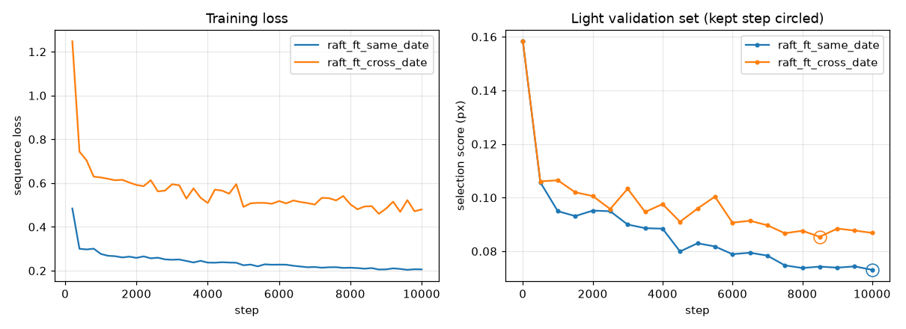
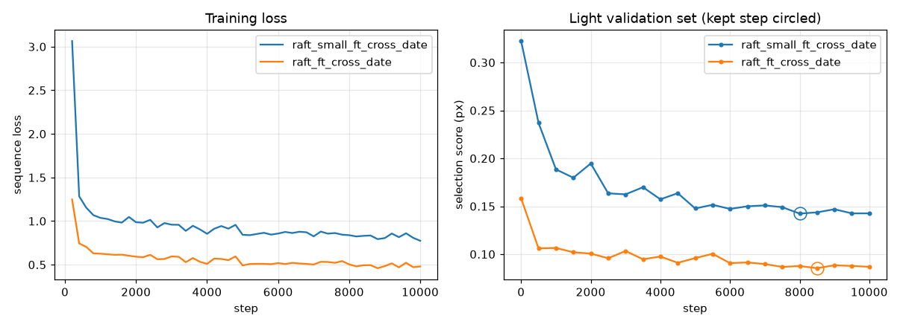
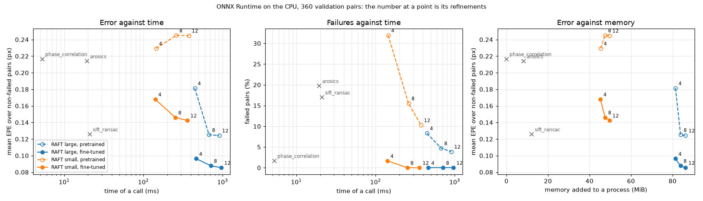

# Running it

The pitch, the results in short and the container command are in
[`README.md`](../README.md). This file is everything past it: the container
image, then how to install `satreg`, register a pair, and reproduce each table
of [`evaluation.md`](evaluation.md), level by level.

## The container image

```bash
docker run --rm --network none ghcr.io/esamoun/ai-satellite-image-registration:1.0.0 register
```

The container image runs `satreg` with no Python to install and no network.
It holds the package, ONNX Runtime, the three classic methods that need no
system library (phase correlation, with and without a Hann window, and
SIFT + RANSAC), and the nine fine-tuned RAFT files under ONNX Runtime: large
and small at 12, 8 and 4 refinements, and the int8 copies of large. Each file
was checked against its pinned SHA-256 when the container image was built.
It also holds the configs, the demo pairs of [`examples/`](../examples/) and
the Beauce benchmark chip, so `satreg register` and a small benchmark both run
with `--network none`.

It does not hold PyTorch, so no pretrained network (RAFT, LightGlue, RoMa) and
no training; nor AROSICS, which needs a system GDAL. The published tables were
made on a laptop and on a Kaggle GPU, with every method: they are reproduced
outside the container image, with `make` (the sections below). The reasoning
is in [`docs/decisions.md`](decisions.md), entries of 2026-10-13.

`satreg register` with no method lists the twelve methods the container image
runs, and stops. With a pair of your own, mount its directory and name a
method:

```bash
docker run --rm --network none --user "$(id -u):$(id -g)" \
    --volume "$PWD:/work" \
    ghcr.io/esamoun/ai-satellite-image-registration:1.0.0 \
    register /work/reference.tif /work/moving.tif \
    --method phase_correlation --out /work/out
```

### Building it yourself

```bash
make container-image        # tagged satreg:local
make container-image-try    # the checks CI runs, with no network
```

The build downloads the nine files of the `weights-n3` release. While the
repository is private it needs a token, passed as a build secret and written to
no layer: `GITHUB_TOKEN=$(gh auth token) make container-image`. Without one,
the files are read from the release's public address. CI builds the container
image on amd64 and on arm64 on every push, and runs `make container-image-try`.

On a Mac without Docker Desktop, [Colima](https://github.com/abiosoft/colima)
runs it. This is how it was installed on the M1 (8 GB) on 2026-10-13:

```bash
brew install colima docker docker-buildx
mkdir -p ~/.docker/cli-plugins
ln -sfn "$(which docker-buildx)" ~/.docker/cli-plugins/docker-buildx
colima start
```

Colima 0.10.3 with its defaults: Apple's virtual machine (`vz`), 2 CPUs and
2 GiB of memory. The `Dockerfile` needs BuildKit, hence `docker-buildx` and its
link. The build took 60 s, nothing cached. Colima's Docker gives two sizes for
the container image: 360 MB compressed, what a `docker pull` downloads, and
1.31 GB on disk, compressed and unpacked together.

### What the M1 gave

On 2026-10-13, the container image built on the M1 from `main` at `9fbef5d`,
every run with `--network none`. The pair is the Beauce demo pair, `clean`,
true shift dx = −1.9443 px, dy = −3.5713 px:

```bash
mkdir -p outputs/container-image
docker run --rm --network none --user "$(id -u):$(id -g)" \
    --volume "$PWD/outputs/container-image:/out" satreg:local \
    register examples/beauce/clean/reference.tif \
    examples/beauce/clean/moving_translation.tif \
    --method phase_correlation --out /out/register-phase_correlation
```

- `--method phase_correlation`: dx = −1.950 px, dy = −3.560 px, 0.013 px from
  the truth, in 0.01 s.
- `--method raft_ft_onnx`: a dense displacement whose mean is dx = −1.936 px,
  dy = −3.579 px, 0.011 px from the truth, in 2.23 s, loading the model
  included. It also writes `flow.tif`.

The small benchmark of
[`configs/container-image.toml`](../configs/container-image.toml): Beauce,
translations, the `clean` and `hard` presets, 20 pairs a cell, the twelve
methods.

```bash
docker run --rm --network none --user "$(id -u):$(id -g)" \
    --volume "$PWD/outputs/container-image:/out" satreg:local \
    benchmark --config configs/container-image.toml --out /out/benchmark
```

It took 17 min 35 s in Colima's machine, against 7 min 33 s on the same M1
outside a container, and the container used about 765 MiB of memory (read
every 15 s with `docker stats`, not a true peak). Its error figures are the
ones to expect (mean end-point error of the pairs that did not fail, in px;
failures are pairs whose error is over 1 px or that the method declined):

| method | clean EPE | hard EPE | hard failures |
|---|---:|---:|---:|
| phase_correlation | 0.0227 | 0.4405 | 0.0 % |
| phase_correlation_hann | 0.0038 | 0.4817 | 10.0 % |
| sift_ransac | 0.0226 | 0.3816 | 75.0 % |
| raft_ft_onnx | 0.0341 | 0.1194 | 0.0 % |
| raft_ft_r8_onnx | 0.0364 | 0.1194 | 0.0 % |
| raft_ft_r4_onnx | 0.0427 | 0.1352 | 0.0 % |
| raft_small_ft_onnx | 0.0690 | 0.1578 | 0.0 % |
| raft_small_ft_r8_onnx | 0.0686 | 0.1631 | 0.0 % |
| raft_small_ft_r4_onnx | 0.0890 | 0.2662 | 0.0 % |
| raft_ft_onnx_int8 | 0.0366 | 0.1210 | 0.0 % |
| raft_ft_r8_onnx_int8 | 0.0395 | 0.1201 | 0.0 % |
| raft_ft_r4_onnx_int8 | 0.0462 | 0.1382 | 0.0 % |

No method fails a `clean` pair. The nine rows of the classic methods and of
the float RAFT files are the M1's own outside a container, to five decimals.
The three int8 rows hold to the third decimal only: outside a container the M1
gives them up to 0.0011 px apart (`raft_ft_r4_onnx_int8`, `hard`: 0.1393).
The container image runs Linux and ONNX Runtime 1.31.0 where that run had
macOS and 1.30.0; which of the two moves them was not looked for. Library
versions are not pinned, so a later build can move a figure in its last
decimals too.

These 20 pairs are the first 20 of the 100 Beauce pairs of the published
tables: a row here is a fifth of a published row, and is not expected to give
its figure.

Times are this Mac's and are given as such. The median time of a call, in ms,
in the container (2 CPUs) and on the M1 outside it (4 threads):

| method | M1 | container |
|---|---:|---:|
| phase_correlation | 4.8 | 5.2 |
| phase_correlation_hann | 7.6 | 7.9 |
| sift_ransac | 15.8 | 26.1 |
| raft_ft_onnx | 839 | 1,929 |
| raft_ft_r8_onnx | 635 | 1,428 |
| raft_ft_r4_onnx | 422 | 897 |
| raft_small_ft_onnx | 336 | 774 |
| raft_small_ft_r8_onnx | 230 | 528 |
| raft_small_ft_r4_onnx | 127 | 283 |
| raft_ft_onnx_int8 | 496 | 1,330 |
| raft_ft_r8_onnx_int8 | 358 | 947 |
| raft_ft_r4_onnx_int8 | 205 | 552 |

## Run it

Python 3.11 or later.

```bash
python -m venv .venv && source .venv/bin/activate
make install
make test
satreg benchmark
```

`satreg benchmark` simulates pairs with known sub-pixel motion, runs every installed
method but RoMa (about 3 s a pair on a laptop CPU, so it runs only when named),
prints the results table and writes it to `outputs/benchmark/` as `summary.md` and
`summary.csv`, with one row per pair and method in `pairs.csv`, and the machine it
ran on in `context.json`. `satreg benchmark --help` lists the options (number of
pairs, image size, motion ranges, seed, failure threshold, timing repeats).

### Register a pair of your own

```bash
satreg register reference.tif moving.tif --method phase_correlation --out out/   # classic
satreg register reference.tif moving.tif --method arosics --out out/             # map coordinates
satreg register reference.tif moving.tif --method raft_ft_onnx --out out/        # fine-tuned RAFT, ONNX Runtime
satreg register reference.tif moving.tif --method raft_ft --out out/             # the same weights, PyTorch
```

`satreg register REF MOVING --method NAME --out DIR` runs one method on two
images you give, a supplied pair. These four lines are examples, one per kind
of method, not a ranking. The method is always named: there is no default, and
`satreg register` without `--method` lists the methods that can run in your
environment (those whose optional packages are installed and whose file is
there) and stops.

It takes two single-band images of the same shape, GeoTIFF or PNG.
`--band N` names the band of a file that has several, and
`--window ROW COL SIZE` cuts the same square window from both. A pair is at
most 512 px a side: a larger one is refused, with `--window` to cut a part of
it, and nothing is tiled. That limit comes from a measurement on the M1
([`docs/results/n4/register-size.md`](results/n4/register-size.md)):
fine-tuned RAFT under ONNX Runtime holds in 0.7 GiB at 512 px and takes over
5 GiB at 1,024 px. Under 128 px a side RAFT pads the pair, which costs
accuracy, and the command says so. Two files that carry different map grids
are refused: put them on one grid first, the command resamples nothing it is
given. AROSICS works in map coordinates and needs GeoTIFFs with their
reference system.

It writes to `DIR`:

- `displacement.json`: the displacement (`moving(p + d) = reference(p)`, in
  pixels), the method, the duration of the call, which includes loading the
  model, and the method's diagnostics;
- `corrected.tif`: the moving image resampled onto the reference, with the
  georeferencing of the input when it has one. Pixels whose content lies
  outside the moving image hold no data;
- `flow.tif`: the displacement of every pixel (`dy`, then `dx`), when the
  method gives a dense one.

A method that declines the pair exits with an error code and its reason, and
writes nothing. No figure of this repository was measured on a supplied pair:
the published ones are on 256 px windows of simulated and real Sentinel-2
pairs.

### The demo pairs

```bash
make demo        # docs/demo/ and examples/, about 40 s on the M1
satreg register examples/beauce/clean/reference.tif \
    examples/beauce/clean/moving_translation.tif \
    --method phase_correlation --out out/
```

`satreg demo` writes what the demo page shows, so the page computes nothing.
For each of the four seen sites it takes one pair of the benchmark, a demo
pair, picked by a rule on its ground truth: the first pair of the site whose
true shift is over 2 px. It draws that pair under `clean` and `hard`, as a
translation and as a dense field, and runs no registration, phase correlation,
SIFT + RANSAC, RAFT and fine-tuned RAFT on each (PyTorch, `make install-dl`).
A method that fails is kept and shown as a failure. The command takes no
held-out site and has no option to change the pairs.

- [`docs/demo/`](demo/): per site and preset, the images as PNG, the
  pixels the fixed change detector flags before and after each correction,
  `pair.json` and `arrows.json` (truth, estimate, error, failure and its
  reason, with no time and no memory), and a copy of the three published
  files of the cost curve;
- [`examples/`](../examples/): the same pairs as GeoTIFF on their map grid, with
  `manifest.json` (site, scene, window, true displacement), for
  `satreg register`. They contain modified Copernicus Sentinel data 2025.

A demo pair is also a pair of the published tables. Showing it measures
nothing and adds no figure to any table.

### Methods

- `phase_correlation`: scikit-image's sub-pixel phase correlation, refined to
  1/100 px. It estimates a single translation.
- `sift_ransac`: OpenCV SIFT keypoints, matched with Lowe's ratio test, and an
  affine transform fitted by RANSAC. With too few inliers it declines the pair,
  which counts as a failure. Its match and inlier counts are in `pairs.csv`.
- `arosics`: [AROSICS](https://git.gfz-potsdam.de/danschef/arosics) global
  co-registration (`COREG`), the standard open-source tool for Sentinel-2. It
  phase-correlates a matching window in map coordinates, on the grid of the chip
  each pair was cut from, and estimates a single translation. It declines a pair
  when it finds no valid match or rates its own result below 40 % reliability.
  The reliability and the window it used are in `pairs.csv`. It is an optional
  extra (below); without it, the benchmark runs the other two.

`--methods` picks some. Method parameters (SIFT's ratio, RANSAC threshold and
minimum inlier count; AROSICS' window, maximum shift and reliability threshold)
are set in [`configs/methods.toml`](../configs/methods.toml). A variant of a method,
with other parameters, is declared there too, as a table with a `method` key, and
runs under its own name: `phase_correlation_hann` (phase correlation with a Hann
window), `arosics_floor60` (AROSICS with a 60 % reliability floor),
`lightglue_disk` (LightGlue on DISK keypoints) and `roma_dense` (RoMa's warp as a
displacement for every pixel) are declared this way.

### AROSICS

AROSICS needs GDAL, whose Python bindings pip builds against a system GDAL of the
same version. On macOS:

```bash
brew install gdal
make install-arosics
```

`make install-arosics` pins the bindings to `gdal-config --version`, then installs
the `arosics` extra (`pip install -e ".[dev,arosics]"`). On Linux, install
`libgdal-dev` first. The test suite runs without it and skips the AROSICS tests,
saying why.

### Deep-learning methods

Three pretrained methods need PyTorch, an optional extra:

- RAFT (`raft`, torchvision's large model, and `raft_small`): optical flow, a
  displacement for every pixel.
- LightGlue (`lightglue`, on ALIKED keypoints, and `lightglue_disk`, on DISK
  keypoints), kornia's implementation: learned keypoints matched by a
  transformer, then the same RANSAC affine fit as `sift_ransac`. Its match and
  inlier counts are in `pairs.csv`.
- RoMa (`roma`, and `roma_dense`), the outdoor model from `romatch`: a dense
  matcher on a DINOv2 backbone that places every reference pixel in the moving
  image and rates each match with a certainty. `roma` fits the RANSAC affine of
  `sift_ransac` to the certain matches, `roma_dense` keeps the warp as a
  displacement for every pixel. Both decline a pair where less than 0.5 % of the
  pixels are certain. The certainty is in `pairs.csv`. RoMa takes about 3 s a
  pair on the M1's CPU and runs only when named, as in
  `satreg benchmark --methods roma roma_dense`.

```bash
make install-dl
make install-roma   # RoMa, on top of the dl extra
```

This installs the `dl` extra (`pip install -e ".[dev,dl]"`) and downloads the
pretrained weights once, to PyTorch's cache (`~/.cache/torch`), outside the
repository. `make install-roma` adds `romatch` 0.1.2 without the dependencies it
declares (see [`docs/decisions.md`](decisions.md)) and its 1.7 GB of weights.
Each method runs on the device set in `configs/methods.toml` (`cpu` by default,
or `mps` or `cuda`); nothing picks one for you. `--device cuda` moves every
deep-learning method of a run to that device, the other methods staying on the
CPU, and stops before the first pair if the machine lacks it. The test suite runs
without the extra and skips the tests that run the networks, saying why.

### Translation, affine and dense motion

Each pair is simulated three times: shifted, under a small affine motion (rotation,
scale change and shear about the pair's centre, on top of the same shift), and
under a dense field (the same affine motion plus a smooth local displacement that
varies across the pair). All three versions share the reference image and the
global motion, so the difference between the rows of a method is the cost of its
motion model. The default affine ranges (±0.2°, ±0.2 % scale, ±0.002 shear) are
sized around the Sentinel-2 co-registration requirement of 0.3 px. The local field
stands for orthorectification residuals over relief: up to 0.8 px, correlated over
about 64 px (640 m). `--scenarios affine` runs one scenario, and `--max-rotation`,
`--max-scale-change`, `--max-shear`, `--max-local-shift` and `--local-length`
change the ranges. Every scenario is warped without the low-pass of a plain
spline. Pixels whose displaced position leaves the moving image are left out of
the metrics, and so are pixels of a dense pair that sit under opaque cloud.

### On Sentinel-2 imagery

```bash
satreg fetch                      # every site in configs/sites.toml
satreg benchmark --site beauce
```

`satreg fetch` finds the least cloudy Sentinel-2 L2A scene of each site in the
[Earth Search](https://earth-search.aws.element84.com/v1) STAC catalogue whose
scene classification (SCL) shows the chip itself free of cloud and cloud shadow,
and reads a 1024 × 1024 px window of its B04 COG, on the native 10 m grid with no
resampling. No account is needed. The chip (about 1.5 MB per site) is cached in
`data/chips/`, which is not committed: later runs make no network call, and
`satreg benchmark --site <name>` fetches a missing chip by itself. Sites, dates,
cloud limits, chip size and band are set in [`configs/sites.toml`](../configs/sites.toml).
Without `--site`, the benchmark uses the synthetic texture and runs offline.

Six sites are declared: Beauce (fields), Toulouse (city), Alps (mountain),
Vosges (forest), Libya-4 (desert) and Marseille (coast). The Alps and Libya-4 are
held out for the final evaluation: the benchmark refuses them unless given
`--allow-held-out`, and a table that includes them says so.

### Across spectral bands

```bash
satreg benchmark --site toulouse --band-pair B04 B08
```

`--band-pair REFERENCE MOVING` (or `band_pairs = [["B04", "B08"]]` in a run
config) cuts the reference image from one band and the moving image from
another. Both come from the same scene and window as the site's chip, and the
moving image is then shifted exactly as in a single-band pair. Red against
near-infrared is the hard case: vegetation is dark in one and bright in the
other. Only the 10 m bands (B02, B03, B04, B08) are offered, so no band is
resampled. The bands are cached as one multi-band chip in `data/chips/`. The band
pair becomes a column of every table, and the option can be repeated. The
ground truth assumes the bands are co-registered, and ESA only guarantees that
to about 0.3 px. `--max-shift 0` measures what is left on a site (see
[`docs/decisions.md`](decisions.md)).

### Real multi-temporal pairs

```bash
satreg real-pairs                 # fetch each site's dates and list its pairs
satreg check-presets              # measure real pairs next to the presets
```

Each site also gets a series of real dates, set in
[`configs/real.toml`](../configs/real.toml). The series starts from the chip's own
scene and adds the clear dates nearest a few days, a season and a year later. All
dates are on the same tile and relative orbit, and are cut from the same window
of the grid. The four dates give six pairs and four triplets per site. A real
pair has no ground truth. It carries both dates, their scenes and satellites, and
a joint cloud and shadow mask from the SCL. Dates are cached in `data/real/`.
`satreg check-presets` measures noise, blur difference, contrast, tone and
correlation on real pairs and on the presets, without registering them, and
writes the comparison to `outputs/presets-check/`. Held-out sites are fetched
but not measured.

```bash
satreg cycle                      # closure of each method on the real triplets
```

A real pair has no truth to score a method against, but three dates do check
each other. For dates A < B < C, `satreg cycle` registers A to B, B to C and A
to C, each on the 256 px windows clear on all three dates. Chained, the first
two legs should give the third. The distance between them, the closure, is
reported per site, triplet and method like the benchmark's error. It has the
same columns: mean, share of pixels under 0.1 and 0.5 px, failures and cost. A
triplet fails if a leg declines or crashes, or if its mean closure exceeds 1 px.
The closure is not the error. An error that belongs to one date, or that
grows with the displacement, cancels out of it. So the same command also runs
simulated triplets, cut from each site's chip under every scenario and preset,
and shows their closure next to their true error. A second table sizes the
displacements the methods find between real dates, next to the simulated
ranges. Output goes to `outputs/cycle/`, with one row per registration in
`legs.csv` and one per triplet in `triplets.csv`. `--simulated-triplets 0`
skips the simulated triplets. Held-out sites are left out unless
`--allow-held-out` is given.

```bash
satreg false-change               # what a residual costs a change detector
```

`satreg false-change` asks what the accuracy is for. One fixed change detector
(a threshold at 3 σ of the pair's noise) is run after each method's correction,
and the pixels it flags where nothing changed are counted. On simulated pairs
nothing changed anywhere, and a reference curve gives the false-change rate as a
function of the residual. On real pairs the count is made on stable ground,
built-up and bare ground in ESA WorldCover. Output goes to
`outputs/false-change/`, with the figure `false_change.png`.

### Training chips

```bash
satreg fetch-train                # fetch and check the twelve training chips
```

Fine-tuning (N3) does not train on the benchmark chips. Its pixels are twelve
other chips, declared in [`configs/train-sites.toml`](../configs/train-sites.toml):
three per landscape (open fields, urban, forest, coast), one of the three set
aside whole for validation, none in mountain or desert. Each gets the four dates
of the series rule above. `satreg fetch-train` fetches them and checks each
chip: its four dates are found, an urban chip is at least 55 % built-up and a
coast chip at most 40 % water in ESA WorldCover. A chip that fails is reported
with its shares and the command exits with an error. The tables go to
`outputs/train-chips/`, with the scene ids, dates and hidden shares in
`chips.json`. The configuration refuses a chip that could overlap a benchmark
chip or a held-out site, and training code gets its chips by role, through a
call that raises for any other chip. `--export DIR` copies the accepted chips to
a directory laid out like `data/`, which is what is uploaded to Kaggle
([docs/kaggle.md](kaggle.md)).

### Training pairs

```bash
make train-pairs                  # draw 200 training pairs, time them, save a contact sheet
satreg train-pairs --cross-date 0 # same-date pairs only
```

A training pair is a 256 px window of a training chip, moved by a known
displacement and degraded by a random draw. The generator
([`trainpairs.py`](../src/satreg/trainpairs.py)) calls the benchmark's simulator
and degradations, it does not copy them: with the exact parameters of a preset
it returns the benchmark's pair, and a test pins it. What differs from the
benchmark:

- **Degradations are drawn in continuous ranges**, from clean (the noise from
  nearly none, a ratio of 40 dB) to a bit beyond `hard`, declared under `[training]` in
  [`configs/degradations.toml`](../configs/degradations.toml). The three presets
  stay the test's.
- **Clouds may fall on both images**: half of the pairs have a cloud on the
  moving image, three in ten on the reference.
- **Two kinds of pair**, in a share set by `cross_date` in
  [`configs/train-pairs.toml`](../configs/train-pairs.toml): same-date (one date,
  exact truth) and cross-date (reference and moving from two dates of one chip).
- **A loss mask** comes with each pair: pixels pushed out of frame, pixels under
  an opaque cloud on either image and, on a cross-date pair, pixels the scene
  classification hides on either date are left out.

Pair number `i` of a seed is always the same pair, whatever was drawn before it.
Only training chips are read: asking for a validation chip raises. The network's
inputs are made by the conversion the `raft` method uses.

The command writes `summary.md`, `pairs.csv` (one row per pair, with its drawn
parameters) and `contact-sheet.png` to `outputs/train-pairs/`. On the M1, one
process makes 5.8 pairs per second: a translation or affine pair takes 11 to
26 ms, a dense pair 0.4 s.

### Training

```bash
make train-overfit                # the overfit run: RAFT large, then small, on 8 pairs (M1, about 11 min)
satreg train --config configs/train-overfit.toml --resume   # go on from the checkpoint
satreg validate --config configs/validation.toml --light --methods raft raft_ft_local
```

`satreg train` fine-tunes RAFT on training pairs ([`train.py`](../src/satreg/train.py)).
The run is declared in one file: the model, the steps, the batch size, the
learning rate and the other settings under `[train]`, what the pairs are made
of, with their seed, under `[pairs]`. The recipe is the one of RAFT's own
fine-tuning stages, read from the original training script and torchvision's:

- **Sequence loss**: the L1 error of each of the 12 refinements, later ones
  weighing more, on the pixels of the loss mask.
- **AdamW under a one-cycle learning rate**, the gradient's norm clipped to 1.
- **Every parameter trains**; the batch-normalisation layers of RAFT large keep
  the statistics of the pretrained weights (RAFT small has none).
- **Same inputs as at inference**: the conversion of the `raft` method, 12
  refinements, 32-bit floats.

The output directory holds `checkpoint.pt` (weights, optimiser, schedule, step
and configuration), `log.csv` (one row per step), `summary.md` and
`context.json` (the configuration, and the commit and machine of each session).
A session that stops is resumed with `--resume`: pair number `i` depends on its
index alone, so a resumed run ends on the weights an uninterrupted one gives,
and a test pins it.

With `validate_every = N` in `[train]`, the run scores its network on the light
validation set before the first step and every `N` steps
([`trainval.py`](../src/satreg/trainval.py)): the 360 pairs `satreg validate
--light` scores, drawn and scored by the same code. Each validation is a line of
`validation.csv` and of `summary.md`. The run keeps, in `best.pt`, the weights
of the validation with the lowest selection score: the mean error over the 360
pairs, the three presets weighing the same, a pair that fails (over 1 px)
counting for 1 px. The pretrained weights, step 0, are a reference and are never
the kept ones. The rule is in [`docs/decisions.md`](decisions.md), written
before the first real run.

Pairs are made on the fly. `workers = N` prepares them in `N` processes, a few
steps ahead of the loop, and gives the same batches as one process: on the M1,
RAFT small at batch 4 goes from 1.49 s per step, 59 % of it making pairs, to
0.64 s with 3 workers. `--max-minutes` stops a run on a checkpoint after that
long, for a session with a time limit.

The real trainings run on a Kaggle GPU, from
[`kaggle/satreg-train.ipynb`](../kaggle/satreg-train.ipynb). Its first use is the
timing run, [`configs/train-timing.toml`](../configs/train-timing.toml): 300 steps
of RAFT large and small on a T4, to measure what the step budget is set from
([`docs/kaggle.md`](kaggle.md#training-on-a-kaggle-gpu)). There, a step of
8 pairs takes 3.1 s for both networks, 70 % of it waiting for the pairs with
large and 89 % with small: Kaggle's 4 CPUs make 2.6 pairs a second. Each
training gets 10,000 steps, about 8.9 h, one session
([`docs/decisions.md`](decisions.md), 2026-10-04).

RAFT large is trained twice, for the ablation:
[`configs/train-same-date.toml`](../configs/train-same-date.toml) on same-date
pairs only, where the truth is exact and nothing changed on the ground, and
[`configs/train-cross-date.toml`](../configs/train-cross-date.toml) with one pair
in two cross-date, where the ground really changed and the truth is off by what
the two dates are misregistered by. The two files differ by `cross_date` alone,
and a test checks it. The methods `raft_ft_same_date` and `raft_ft_cross_date`
load the `best.pt` each run kept, from `outputs/train/large-same-date/` and
`outputs/train/large-cross-date/`. How the two are compared is under
[Validation set](#validation-set).

RAFT small is trained once, with the pairs the ablation retained:
[`configs/train-small.toml`](../configs/train-small.toml) is
`train-cross-date.toml` but for `model`, and a test checks it. Same pairs
(pair number i is the same pair in both trainings), same 10,000 steps, same
optimiser settings; freezing batch normalisation changes nothing for it, since
it has none. On Kaggle it costs what RAFT large costs, about 9 h: the GPU waits
for the pairs 89 % of the time. The method `raft_small_ft_cross_date` loads the
`best.pt` of `outputs/train/small-cross-date/`.

The methods `raft_ft_local` and `raft_small_ft_local` of
[`configs/methods.toml`](../configs/methods.toml) are RAFT with the weights of a
checkpoint at a local path, `outputs/train/raft_ft/checkpoint.pt` and
`outputs/train/raft_small_ft/checkpoint.pt`, where `satreg train` writes by
default: a training still at work. They run through the same commands as any
method; without the checkpoint, a command says where it is expected and their
tests are skipped. The weights a training ends with are published, and run as
`raft_ft` and `raft_small_ft`: see [Fine-tuned weights](#fine-tuned-weights).

The overfit run ([`configs/train-overfit.toml`](../configs/train-overfit.toml))
checks the loop, it does not make a model: 300 steps on the same 8 training
pairs, on the M1 (MPS).

| model | s/step | loss, first 30 steps | loss, last 30 | EPE on the 8 pairs, pretrained | after 300 steps |
|---|---:|---:|---:|---:|---:|
| large | 1.80 | 1.572 | 0.054 | 4.241 px | 0.009 px |
| small | 0.33 | 3.380 | 0.140 | 6.248 px | 0.018 px |

The pretrained error is high because of one pair with a cloud on both images,
where the pretrained weights are 31 px off (46 px for small); the others are
between 0.04 and 3.1 px, and every pair ends under 0.03 px.

Both checkpoints then went through `satreg validate --light` like any method
(360 pairs of the validation chips, which the training never saw):

| preset | method | EPE (px) | failures |
|---|---|---:|---:|
| clean | raft | 0.062 | 0.0 % |
| clean | raft_ft | 0.067 | 0.0 % |
| clean | raft_small | 0.145 | 0.0 % |
| clean | raft_small_ft | 0.183 | 0.0 % |
| mild | raft | 0.073 | 0.0 % |
| mild | raft_ft | 0.076 | 0.0 % |
| mild | raft_small | 0.191 | 0.8 % |
| mild | raft_small_ft | 0.188 | 0.0 % |
| hard | raft | 0.253 | 11.7 % |
| hard | raft_ft | 0.242 | 0.0 % |
| hard | raft_small | 0.463 | 30.0 % |
| hard | raft_small_ft | 0.544 | 24.2 % |

These rows show that a checkpoint reaches the table by the normal path, and
nothing else: 8 pairs and 300 steps are not a training, the light set's failure
rate is not reliable under `hard`, and no conclusion is drawn from them. The
tables are in [`docs/results/n3/`](results/n3/). In them `raft_ft` and
`raft_small_ft` are the two overfit checkpoints, read from their local path:
the methods named `raft_ft_local` and `raft_small_ft_local` since the weights
were published.

### Validation set

```bash
make validation                   # pretrained RAFT on the validation set (M1, about 27 min)
make validation-light             # its light version, the first 10 pairs of every cell
make validation-cycle             # closure on the real triplets of the twelve chips
make ablation                     # both, for raft and the two fine-tuned variants, then the choice (M1, about 75 min)
make small                        # both, for RAFT small and large, pretrained and fine-tuned, then the verdict (M1, about 71 min)
```

The validation set is what N3's choices are made on: 100 simulated pairs per
validation chip (Santerre, Lyon, Morvan, Sète), scenario and preset, 3,600 in
all, declared in [`configs/validation.toml`](../configs/validation.toml).
`satreg validate` cuts them from the chips' anchor date and hands them to the
code `satreg benchmark` runs, with the ranges, presets and seed of the N2 table:
a validation row is computed like a row of the final table, on other chips. The
table comes over every chip, then by chip.

`satreg validate-cycle` scores the closure of the real triplets, as
`satreg cycle` does, on the four date series of the twelve chips: the validation
chips, which choose, and the training chips, which are reported. Both commands
take their chips from [`configs/train-sites.toml`](../configs/train-sites.toml) by
role, so neither can read a benchmark chip or a held-out site.

Pair number `i` of a cell does not depend on how many pairs are asked for, so
`--light` runs the first `light_pairs` pairs of every cell (360 pairs): the set
scored during a training. The full run prints how light sets of several sizes
compare with it.

Pretrained RAFT, the bar a fine-tuned checkpoint is compared with, over the four
chips and the three scenarios (M1, MPS):

| preset | method | EPE (px) | failures |
|---|---|---:|---:|
| clean | raft | 0.063 | 0.0 % |
| clean | raft_small | 0.141 | 0.0 % |
| mild | raft | 0.081 | 0.0 % |
| mild | raft_small | 0.176 | 0.4 % |
| hard | raft | 0.242 | 5.8 % |
| hard | raft_small | 0.482 | 26.9 % |

On real triplets of the validation chips, RAFT closes at 0.21 px with 32 % of
failures and RAFT small at 0.29 px with 42 %; almost all of Santerre fails, as
Beauce does in N2. The full tables are in
[`docs/results/n3/`](results/n3/).

`make ablation` runs both commands for pretrained `raft` and the two variants
of the ablation, then `satreg ablation` ([`ablation.py`](../src/satreg/ablation.py))
reads the two tables. Each variant is put next to `raft`, and the two next to
each other, always on the same items: the mean error over the pairs neither of
the two fails, the mean closure over the triplets neither fails, and the
failure counts. It reads them from `validation/` and `validation-cycle/` under
`outputs/ablation/`, writes `summary.md`, `comparisons.csv`, the loss and
validation curves of the two trainings (`curves.png`) and `context.json` next
to them, and applies the rule written before the trainings:

1. a variant is eligible if it beats pretrained `raft` on the whole validation
   set (no more failed pairs, a lower mean error);
2. if neither is, nothing is retained, and that is the result;
3. if one is, it is retained;
4. if both are, the closure on the real triplets of the four validation chips
   chooses (fewer failed triplets, then a lower mean closure);
5. if it is equal, the lower validation error, then the same-date variant.

The closure on the eight training chips is reported and decides nothing: the
cross-date variant was trained on their dates. The report also gives the two
variants' closure on each validation chip, since step 4 can come down to one.

The rule is applied to the two trainings of the ablation only. If the two runs
differ by more than `cross_date`, if the same-date variant's run has cross-date
pairs, or if a run stopped short of its step budget, the report gives the
tables, says why, and chooses nothing. `satreg ablation` also refuses what is
not the rule's input: the light validation set, a run given other options than
its run configuration says (fewer pairs, some chips), a validation run on other
scenes than the trainings validated on, a closure run that misses a chip. A run
of `satreg validate` or `satreg validate-cycle` records the SHA-256 of each
fine-tuned method's checkpoint in its `context.json`; two runs that did not
score the same weights are refused, and so are weights rewritten since. The
rule and its limits (no margin, one seed) are in
[`docs/decisions.md`](decisions.md), 2026-10-05.

The two trainings ran on Kaggle, 10,000 steps each, and the rule retains the
cross-date variant. Both beat pretrained RAFT on the validation set, so the
closure on the validation chips chose (M1, MPS):

| method | validation set: failed pairs | EPE (px) | validation chips: failed triplets | closure (px) |
|---|---:|---:|---:|---:|
| raft | 70 of 3,600 | 0.127 | 78 of 241 | 0.209 |
| raft_ft_same_date | 0 | 0.071 | 0 | 0.122 |
| raft_ft_cross_date | 0 | 0.084 | 0 | 0.106 |

The two fine-tuned rows are read one against the other, over every pair and
every triplet; pretrained RAFT's row is over the 3,530 pairs and the 163
triplets it does not fail, where the two variants are at 0.068 and 0.080 px of
error and 0.094 and 0.090 px of closure. The same-date variant is the better one on
the simulated pairs, in each of the nine cells, and the cross-date one on real
triplets, on three validation chips of four. That is one seed and no margin:
the gap that chose is 0.016 px. The tables are in
[`docs/results/n3/ablation.md`](results/n3/ablation.md), and what the
losing variant did better in [`docs/decisions.md`](decisions.md),
2026-10-06.



`make small` does the same for four methods, `raft_small`,
`raft_small_ft_cross_date`, `raft` and `raft_ft_cross_date`, under
`outputs/small/`, then `satreg small` ([`small.py`](../src/satreg/small.py)) reads
the fine-tuned RAFT small with the paired readings of the ablation, next to:

1. pretrained `raft_small`: what the training changed;
2. `raft_ft_cross_date`: what is left to RAFT large, both fine-tuned;
3. pretrained `raft`: whether a fine-tuned small reaches the large one as it
   was;
4. and `raft_small` next to `raft`, the gap before any training.

The training gets one of three words, defined before it ran
([`docs/decisions.md`](decisions.md), 2026-10-06), from the first reading
on the whole validation set. A **gain** if the fine-tuned model beats the
pretrained one: no more failed pairs, and a lower mean error over the pairs
neither fails. **Worse** if the pretrained one beats it, the same criterion the
other way round. **No gain** otherwise. The closures and the three other
readings are reported and do not change the word. A run that was not given what
the retained training of RAFT large was but for the model, or that stopped
short of its step budget, gets the tables and no verdict; what `satreg
ablation` refuses, `satreg small` refuses too.

The training ran on Kaggle, 10,000 steps, and it is a **gain**: the fine-tuned
RAFT small fails 3 pairs of the validation set where the pretrained one fails
328, with half its error on the others (M1, MPS):

| method | validation set: failed pairs | EPE (px) | validation chips: failed triplets | closure (px) | ms per pair |
|---|---:|---:|---:|---:|---:|
| raft_small | 328 of 3,600 | 0.245 | 102 of 241 | 0.287 | 59 |
| raft_small_ft_cross_date | 3 | 0.138 | 0 | 0.152 | 57 |
| raft | 70 | 0.127 | 78 | 0.209 | 147 |
| raft_ft_cross_date | 0 | 0.084 | 0 | 0.106 | 150 |

The two fine-tuned rows are read one against the other, over the 3,597 pairs
neither fails and every triplet; each pretrained row is over the pairs and the
triplets it and the fine-tuned small do not fail (3,272 and 139 for
`raft_small`, 3,530 and 163 for `raft`), where the fine-tuned small is at 0.122
and 0.132 px of error and 0.093 and 0.119 px of closure. So the fine-tuned
small does not reach the fine-tuned large, in any of the nine cells: its error
was 2.2 times the large model's before training and is 1.6 times now. Next to
RAFT large as it was, it fails far fewer pairs and closes better, is ahead
under `hard` and behind under `clean` and `mild`, and its mean error is
0.006 px higher, so by the criterion it does not beat it. It runs in 0.4 of the
time; training it took the same 9 h. That is one seed, on the validation set;
the held-out sites were read afterwards, once, in
[the final evaluation](evaluation.md). The tables are in
[`docs/results/n3/small.md`](results/n3/small.md), and the limits in
[`docs/decisions.md`](decisions.md), 2026-10-07.



### Fine-tuned weights

```bash
# once: 25 MB, to PyTorch's cache
GITHUB_TOKEN=$(gh auth token) satreg fetch-weights raft_large_ft raft_small_ft
satreg validate --config configs/validation.toml --light --methods raft raft_ft
```

`raft_ft` and `raft_small_ft` are RAFT large and RAFT small with the weights
the two trainings above kept, the `best.pt` of `large-cross-date` and of
`small-cross-date`. The two files are assets of the GitHub release
[`weights-n3`](https://github.com/esamoun/ai-satellite-image-registration/releases/tag/weights-n3),
and `satreg` fetches them by itself, as torchvision does for the pretrained
ones: on first use a method downloads its file to PyTorch's cache
(`~/.cache/torch/hub/checkpoints/`), outside the repository, and checks its
SHA-256 against the one pinned in [`src/satreg/weights.py`](../src/satreg/weights.py).
A file with another hash is refused and not kept. `satreg fetch-weights` does
the same ahead of a run, for the files it is given.

Each published file is the `best.pt` itself, byte for byte: the network's
weights with the training's configuration, chips and commit, and no optimiser
state (21 MB and 4 MB). So the pinned hashes are the ones the tables above
recorded in their `context-*.json`, and a test checks it. A JSON beside each
asset repeats what the file says of its training, for a reader without PyTorch.

**The token.** The repository is private for now, and so are its release
assets: the download needs a GitHub token that can read the repository's
contents, the one of `gh auth token` or a fine-grained token limited to this
repository with *Contents: read-only*. `satreg` reads it from the environment
variable `GITHUB_TOKEN`, sends it to `api.github.com` and nowhere else, and
writes it nowhere: not to a file, not to `context.json`, not in a message.
Without a token and without the files in the cache, a command that names
`raft_ft` stops before its first pair and says to set one. No command runs the
two methods unless they are named, the tests that need the files are skipped,
and CI downloads nothing.

| where | how the weights get there |
|---|---|
| M1 | `GITHUB_TOKEN=$(gh auth token) satreg fetch-weights raft_large_ft raft_small_ft`, once; or, with no token, `satreg fetch-weights --from outputs/release` after `satreg export-weights` |
| Kaggle | the benchmark notebook runs `satreg fetch-weights` for the two files with the `GITHUB_TOKEN` secret that already clones the repository ([`docs/kaggle.md`](kaggle.md)) |
| CI | nothing is downloaded: the download is tested against a stand-in for GitHub, the wrong hash included |

The day the repository is public, the same code downloads the same files
without a token, from the release's public address, and the token and the
Kaggle secret are no longer needed.

**Publishing.** `satreg export-weights` copies each `best.pt` from
`outputs/train/` to `outputs/release/` under its asset name, after checking it
is the pinned file, writes the JSON and the release's notes, and prints the
`gh release create` command; it publishes nothing. New weights are a new entry
of `weights.RELEASED` and a new asset: an asset's name holds the start of its
hash, so a file is never replaced under the same name.

### RAFT under ONNX Runtime

```bash
make install-onnx   # onnx and onnxruntime, beside the dl extra
make onnx           # satreg export: twelve files in outputs/onnx/, half a minute
satreg validate --config configs/validation.toml --light --methods raft_ft raft_ft_onnx
```

`satreg export` writes RAFT to [ONNX](https://onnx.ai), a file format a network
is saved in with its weights, which ONNX Runtime then runs on the CPU without
PyTorch. One file holds one model, its weights and a fixed number of
refinements of the flow (the loop is unrolled in the file), with the image size
left free: the large and the small model, pretrained and fine-tuned, with 4, 8
and 12 refinements, twelve files. Each is checked before it is kept: its flow
under ONNX Runtime against PyTorch's on one 256 px pair, refused over 0.001 px.
The twelve are between 1.3e-5 and 5.1e-5 px apart
([`docs/results/n3/onnx.md`](results/n3/onnx.md)). That is one pair. Over
the 360 pairs of the light validation set the two runtimes agree wherever the
model works, to 2.2e-6 px for the fine-tuned models. On pairs both fail, far
from the truth, the pretrained models come apart by up to 0.2 px (large) and
1.0 px (small); no pair changes verdict. A file says what it holds (model,
refinements, the weights' name and SHA-256) in its metadata, and a run that
uses it records that in `context.json`.

Every RAFT method has its twin under ONNX Runtime, named with `_onnx`, and both
exist with fewer refinements, named with `_r4` and `_r8`: `raft_small_ft_r4` is
RAFT small, fine-tuned, with 4 refinements under PyTorch, and
`raft_small_ft_r4_onnx` the same model under ONNX Runtime. The weights are the
same as with 12 refinements, the count they were trained with; nothing is
retrained. All are declared in [`configs/methods.toml`](../configs/methods.toml),
where an ONNX method takes its file (`file`, a path, or `release`, a published
file) and the threads a call may use (`threads`).

The six fine-tuned files are assets of the release `weights-n3` beside the
weights, pinned by their SHA-256 in
[`src/satreg/weights.py`](../src/satreg/weights.py) and downloaded on first use
like them, as are the three int8 copies of the section below
(`satreg fetch-weights` with no name fetches the eleven files, about 120 MB). So running a fine-tuned model under ONNX Runtime needs the `onnx`
extra and neither PyTorch nor `satreg export`. The pretrained files are not
published again: `make onnx` writes them from torchvision's weights. The export
gave the same bytes twice on the M1; another version of PyTorch may not, which
is why a published file is identified by its own hash and not by the weights
it came from.

### The cost curve

```bash
make curve                      # four runs on the M1, about 5 hours in all
satreg footprint --methods raft_ft_onnx raft_ft --out outputs/footprint
satreg curve --out outputs/curve
```

The cost curve is what each RAFT model costs against what it gets right: the
large and the small model, pretrained and fine-tuned, with 4, 8 and 12
refinements, under ONNX Runtime on the M1's CPU, with the classic methods
beside them. `make curve` runs what it reads, one run at a time and with
nothing else on the machine: the twelve models under PyTorch on the full
validation set (2 h 07), for what fewer refinements do to the error; the
twelve under ONNX Runtime with the classic methods, then under PyTorch, on the
light validation set and on the CPU ([`configs/curve.toml`](../configs/curve.toml),
1 h 45 and 1 h 02), for their time; and their footprints (6 minutes), for
their memory. `satreg curve` then writes the tables, `points.csv` and the
figure, and refuses runs that were not made on the same pairs.



| model, fine-tuned | refinements | EPE (px) | failures | time, ONNX Runtime (ms) | time, PyTorch (ms) | time, PyTorch on a T4 (ms) | memory added, ONNX Runtime (MiB) | memory added, PyTorch (MiB) |
|---|---:|---:|---:|---:|---:|---:|---:|---:|
| RAFT large | 4 | 0.0963 | 0.0 % | 464 | 239 | 23 | 81.4 | 295.0 |
| RAFT large | 8 | 0.0878 | 0.0 % | 713 | 305 | 35 | 83.8 | 295.0 |
| RAFT large | 12 | 0.0854 | 0.0 % | 964 | 371 | 46 | 86.2 | 297.4 |
| RAFT small | 4 | 0.1680 | 1.7 % | 141 | 52 | 17 | 45.2 | 79.9 |
| RAFT small | 8 | 0.1461 | 0.0 % | 253 | 79 | 24 | 47.5 | 83.7 |
| RAFT small | 12 | 0.1424 | 0.0 % | 360 | 106 | 32 | 49.6 | 83.7 |

On these 360 validation pairs, phase correlation is at 0.2165 px and 1.7 % of
failures in 5.3 ms, and SIFT + RANSAC at 0.1257 px and 16.9 % in 21 ms. The
pretrained points, the whole-process memory and the effect of fewer
refinements on the 3,600 pairs are in
[`docs/results/n3/curve.md`](results/n3/curve.md). What it says:

- Run with 8 refinements instead of the 12 they were trained with, the
  fine-tuned models lose under 0.005 px; with 4, 0.013 px for the large one
  and 0.037 px for the small one. Nothing is retrained.
- On this CPU ONNX Runtime is 1.9 to 3.5 times slower than PyTorch, and adds
  32 to 213 MiB less to a process. What the export brings here is a model that
  runs without PyTorch and in less memory, not a faster one.
- A time under ONNX Runtime depends on what the machine did just before: a
  call on a rested machine takes 640 ms where the sustained run reads 905 ms
  (RAFT large, pretrained, 12 refinements), and PyTorch does not move. The
  curve gives the sustained run; differences under 10 % between two points
  are not to be read.

The T4 column is a run of the same PyTorch methods on the same 360 pairs on a
Kaggle GPU ([`docs/kaggle.md`](kaggle.md),
[`docs/results/n3/curve-gpu-light.md`](results/n3/curve-gpu-light.md)),
from which only the time is read. Against PyTorch on the M1's CPU the T4 is 8
to 10 times faster for the large model and about 3 times for the small one.
The held-out sites are not read by any of this: the same curve on the
held-out pairs, with the int8 copies, is in
[the N3 results](evaluation.md#results-the-cost-curve-on-the-held-out-pairs).

### Int8 copies

```bash
make int8                       # needs `make onnx`; about 40 minutes on the M1
```

An int8 copy is an exported model whose convolutions compute on 8-bit integers
instead of 32-bit floats (quantization): a file three times smaller and a
shorter call, for a flow that moves a little. `satreg quantize` writes two
kinds from a fine-tuned file. A static copy sets the scale of each integer
once, on 36 calibration pairs of the validation set, one per chip, scenario
and preset, none of which is scored afterwards; a dynamic copy works its
scales out at each call and needs no pair. `satreg int8` then reads each copy
next to the float file it was made from, on the 360 pairs of the light
validation set: on every pair the float file runs, then its copies, so that
the two times are read seconds apart
([`configs/quantization.toml`](../configs/quantization.toml)).

| model, fine-tuned | refinements | file | MB | EPE (px) | failures | time (ms) | share of float | flow moved (px) | memory added (MiB) |
|---|---:|---|---:|---:|---:|---:|---:|---:|---:|
| RAFT large | 12 | float | 21.5 | 0.0854 | 0.0 % | 913 | | | 87.6 |
| | | static int8 | 7.1 | 0.0889 | 0.0 % | 552 | 0.60 | 0.018 | 100.2 |
| | | dynamic int8 | 6.3 | 0.0934 | 0.0 % | 656 | 0.72 | 0.035 | 86.7 |
| RAFT large | 8 | float | 21.3 | 0.0878 | 0.0 % | 691 | | | 85.0 |
| | | static int8 | 6.7 | 0.0911 | 0.0 % | 392 | 0.57 | 0.019 | 83.2 |
| RAFT large | 4 | float | 21.2 | 0.0963 | 0.0 % | 464 | | | 83.4 |
| | | static int8 | 6.4 | 0.1005 | 0.0 % | 232 | 0.50 | 0.024 | 77.5 |
| RAFT small | 12 | float | 4.3 | 0.1424 | 0.0 % | 368 | | | 50.2 |
| | | static int8 | 2.0 | 0.1838 | 0.0 % | 293 | 0.80 | 0.107 | 52.9 |
| | | dynamic int8 | 1.9 | 0.1998 | 0.0 % | 333 | 0.91 | 0.127 | 50.0 |

"Flow moved" is the mean distance between the flow of a copy and of its float
file on a pair. The times are those of this run, a few percent from the
curve's. By preset in [`docs/results/n3/int8.md`](results/n3/int8.md);
the files and what each computes on integers in
[`int8-files.md`](results/n3/int8-files.md). What it says:

- On RAFT large a static copy takes 40 to 50 % off the time for 0.003 to
  0.004 px more error, and fails no pair. The copy at 8 refinements is faster
  and more accurate than the float file at 4.
- Static beats dynamic, on time and on error.
- On RAFT small it does not pay: 20 % off the time for 0.041 px more, where
  running the float file with 8 refinements takes 30 % off for 0.004 px.
- The file is three times smaller; the memory a process needs is not.
- It is still not faster than PyTorch on this CPU (371 ms at 12 refinements,
  239 ms at 4): at 4 refinements the two are level.

Not everything can go to integers. ONNX Runtime has no int8 version of
`GridSample`, the operator RAFT reads its correlation pyramid with, and the
25 convolutions that read the flow, write its update or write the upsampling
mask are left in float on purpose: quantized too, they move the flow twice as
much on RAFT small. A static copy of the large model computes 165 of its 190
convolutions on integers. Those become four times faster and the call 1.6
times: the lookups and the arithmetic that prepares their coordinates, which
stay in float, are then two thirds of it
([`docs/decisions.md`](decisions.md)).

The three static copies of RAFT large are in the release `weights-n3`, as the
methods `raft_ft_r4_onnx_int8`, `raft_ft_r8_onnx_int8` and
`raft_ft_onnx_int8`. The dynamic copy and the two copies of RAFT small are
measured and not published: `make int8` writes them.

### Under degraded conditions

Each pair is run clean and under named degradation presets, declared in
[`configs/degradations.toml`](../configs/degradations.toml): `mild` and `hard` add
sensor noise, blur, a radiometric difference (contrast, level, tone curve) and
procedural clouds, at increasing strength. Every preset keeps the pair's
geometry, so the ground truth stays exact. `satreg benchmark` runs every preset;
`--degradations mild hard` picks some.

The table reports, per site, scenario, preset and method: the share of the moving image
under cloud, the mean end-point error (EPE, in pixels), the share of pixels whose
error is under 0.1 px and under 0.5 px, and the failure rate.

### Compute cost

Next to accuracy, the table reports what each method call costs: its wall-clock
time, the median of `--repeats` calls (default 3) after `--warmup` untimed calls
(default 1), and its peak memory as traced by Python's `tracemalloc`. Only the
method call is measured, not the simulation or the scoring. `tracemalloc` misses
memory that native code allocates for itself, so SIFT's figure is about a tenth of
what it really uses; the limits are measured in
[`docs/decisions.md`](decisions.md). PyTorch methods are measured their own
way: the device is synchronised before each clock read, and memory is the peak
held by tensors (read by PyTorch's profiler on CPU, by CUDA's counter on GPU, and
not available on MPS). The table's footnote says which methods were measured
which way. A method run by ONNX Runtime has no memory figure per call (no
counter sees what it allocates): its memory is its *footprint*, what calling
it adds to the resident memory of a new process that does nothing else, read
by `satreg footprint` in three processes. It counts the weights and what the
runtime keeps, so it is not compared with a peak per call. `context.json`
records the CPU, memory, thread settings, library
versions, the commit, the GPU if one was used, and each method's device, so
that runs on different machines are not mixed up. The table has a `device`
column.

### On a Kaggle GPU

The M1 has no CUDA device. [`kaggle/satreg-gpu-benchmark.ipynb`](../kaggle/satreg-gpu-benchmark.ipynb)
runs [`configs/gpu.toml`](../configs/gpu.toml) on a Kaggle GPU and saves the run as
its output; the same config runs on the M1 with `--device cpu`. `satreg merge`
puts the two runs in one table, by device, without re-running either:

```bash
satreg merge outputs/gpu-m1 outputs/kaggle/outputs/gpu --out outputs/gpu-merged
```

It refuses runs that measured the same device, or whose pairs or scoring differ.
The procedure, where the weights go and how long a run takes are in
[`docs/kaggle.md`](kaggle.md).

### The N3 run

```bash
make install-dl install-arosics install-roma install-onnx
make onnx      # the pretrained ONNX files, once
make n3-dry    # the rehearsal: every command on the four seen sites, about 55 min
make n3        # the final evaluation, 8 h 56 on the M1 when it ran
```

`make n3` is the final evaluation of N3: the one read of the two held-out
sites, `alps` and `libya4`, after the freeze written in
[`docs/decisions.md`](decisions.md). It runs the M1 part of
[`configs/n3.toml`](../configs/n3.toml) (the simulated table, the closure of real
triplets, the false change), of [`configs/n3-bands.toml`](../configs/n3-bands.toml)
and of [`configs/n3-curve.toml`](../configs/n3-curve.toml), and merges the GPU
part, which the Kaggle notebook produces first from
[`configs/n3-gpu.toml`](../configs/n3-gpu.toml) and
[`configs/n3-curve-gpu.toml`](../configs/n3-curve-gpu.toml)
([`docs/kaggle.md`](kaggle.md)). Then two commands read the runs without
scoring anything:

```bash
satreg final --table outputs/n3 --closure outputs/n3-cycle   # the verdict
satreg curve --benchmark --gpu outputs/kaggle/outputs/n3-curve-gpu --out outputs/n3-curve
```

`satreg final` answers the criterion written before the training, yes or no:
on the 1,800 held-out pairs, fine-tuned RAFT large fails at most as many pairs
as the pretrained one and has a lower mean EPE on the pairs neither fails. It
gives the difference with a 95 % interval, by site and by cell, the same for
RAFT small, and the closure of the real triplets as better, equal or worse. It
refuses a table that was not run as its config says, or whose fine-tuned
weights are not the published ones.

A command stops on a held-out site unless it is given `--allow-held-out`,
which only the recipe of `make n3` does. `make n3-dry` never does: it runs the
same commands on seen sites, two pairs a cell, to check that they run and read
each other's tables, and its reading is headed as a rehearsal.

`make n3` ran once, on 2026-10-12. Its tables and their reading are in
[`docs/evaluation.md`](evaluation.md), and the files as the run wrote them
in [`docs/results/n3/final/`](results/n3/final/). The held-out sites are
now read: the command stays as the record of what ran, the published files are
not regenerated, and nothing may be tuned on these sites.

### The N2 run

```bash
make install-dl install-arosics install-roma
make n2
```

`make n2` runs the M1 part of the published N2 tables (about 5 h 30) and merges
the GPU part, which the Kaggle notebook produces first from
[`configs/n2-gpu.toml`](../configs/n2-gpu.toml) and
[`configs/n2-bands-gpu.toml`](../configs/n2-bands-gpu.toml) (about 2 h 25 on a T4).
The commands, configs, pair counts and hardware are in
[`docs/evaluation.md`](evaluation.md); the tables as the runs wrote them
are in [`docs/results/n2/`](results/n2/).

### The N1 run

```bash
satreg benchmark --config configs/n1.toml   # or: make n1
```

[`configs/n1.toml`](../configs/n1.toml) holds every option of the run that produced
the published table: sites, scenarios, presets, methods, number of pairs, motion
ranges and seed. Its keys are the options of `satreg benchmark`, and an option
given on the command line overrides its key (`--pairs 10` for a quick check).
Every option a run used is recorded in its `context.json`. The table and its
reading are in [`docs/evaluation.md`](evaluation.md).
